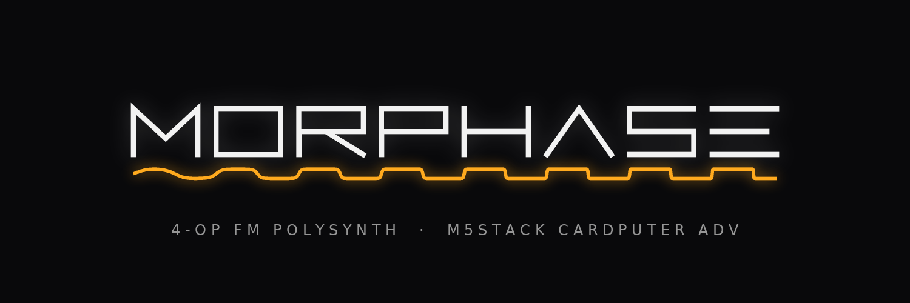
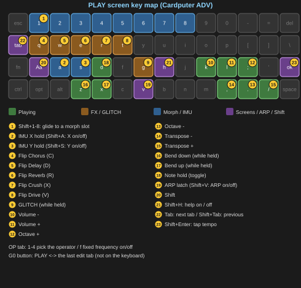

<p align="center"></p>

*[日本語版はこちら / Japanese version here](README_ja.md)*

Firmware that turns the **M5Stack Cardputer ADV** into a **4-operator FM polyphonic synthesizer**, developed with PlatformIO and the Arduino framework. I describe my ideas to Claude, and Claude writes the code.

MORPHASE (*Morph + Phase*) is a 12-note polyphonic FM synth that you play from a MIDI keyboard. The Cardputer is not the keyboard: it is the editor and controller for the sound. You can also move the sound by tilting the unit or waving your hand over a distance sensor.

It is deliberately the opposite of its sibling project, [C.P.S. (CardPuter Synth)](https://github.com/oldtokage-collab/C.P.S.--Cardputer-SYHNTH--).

| | C.P.S. | MORPHASE |
|---|---|---|
| Synthesis | Subtractive (analog-style) | 4-operator FM + waveform morphing |
| Polyphony | Monophonic | **12-note polyphonic** (10 on the BLE build) |
| Played on | The Cardputer's keyboard | **A MIDI keyboard** |
| The Cardputer is | The keyboard | The sound editor / controller |

### How it came about

After C.P.S., I had decided the next project would be a polyphonic synth that could play chords. But building C.P.S. taught me that the Cardputer's own keyboard can't reliably register several keys pressed at once. Its small keys easily miss simultaneous presses, which makes it a poor keyboard for chords.

So for MORPHASE I made a clean break: **it is not played on the Cardputer at all.** Playing is left to a MIDI keyboard, and the Cardputer concentrates on being the editor and controller for the sound. Everything the keyboard handling used to cost went into the sound instead. That budget pays for 12-note polyphony, 14 algorithms, patch morphing, GLITCH and the theremin — the aim was a synth that makes more interesting sounds and is more interesting to play.

**The name.** MORPHASE combines *Morph* (to change shape) and *Phase*. FM makes its tones by wobbling the phase of one wave with another (FM synths such as the DX7 actually work by phase modulation). In MORPHASE the operators' waveforms themselves change shape (morph) too, and the whole sound can travel from patch to patch. The name means "a synth that wobbles phase and keeps changing shape".

**BLE MIDI.** Building around a MIDI keyboard put up a wall: anyone without a Unit MIDI couldn't play it. So, in the final stretch of development, I added a **BLE build** that can be played over Bluetooth from an iPhone / iPad and more. Bluetooth takes a large share of the memory and processing headroom, so the price is two notes of polyphony (12 → 10). In return, you can play MORPHASE from the phone or tablet in your hand, without a single cable.

I share development progress on Reddit and on my [Twitter (X) account](https://x.com/Tokagetchi).

> **This project is currently 100% vibe-coded!**
> My apologies to anyone uncomfortable with AI use or vibe coding!

> **Status: v1.0 — first public release.**

---

## Manuals

If you're new, start with the **Quick Start Guide**; to look up any feature in detail, use the **Reference Guide**. The PDFs can be read offline at any time.

| Guide | English | 日本語 |
|---|---|---|
| Quick Start Guide | [Markdown](docs/QuickStart_en.md) / [PDF](docs/QuickStart_en.pdf) | [Markdown](docs/QuickStart_ja.md) / [PDF](docs/QuickStart_ja.pdf) |
| Reference Guide | [Markdown](docs/Reference_en.md) / [PDF](docs/Reference_en.pdf) | [Markdown](docs/Reference_ja.md) / [PDF](docs/Reference_ja.pdf) |


---

## Key Features

### The FM engine

- **4-operator FM with 14 algorithms**: 8 built around the classic 4-operator FM layouts, plus 6 with feedback in different places (for sawtooth, growl and metallic sounds)
- **Waveform morphing**: an operator's waveform is not fixed to a sine. It slides smoothly through 8 waveforms ordered by brightness (Sine → Squeeze → HalfSine → Parabolic → ESquare → Saw2 → ESaw → Square2). `GMorph` moves all four operators together
- **Fixed-frequency operators and a pitch envelope**: build percussion such as kicks, toms and metal hits
- **12-note polyphony** (10 on the BLE build). Mono, legato and glide too

There is deliberately no filter. FM shapes its tone in the operators, so the processing a filter would cost goes into polyphony instead.

### Patch morph: from sound to sound

- Moves between patches lined up in 8 slots, blending everything: ratios, envelopes, FX
- Two ways: a **chain**, where a knob, tilt or LFO moves the "position", and **glide**, which slides to a chosen patch with `Shift+1–8` or MIDI pads
- Chains can be saved under a name and switched one after another from a MIDI button


### GLITCH: breaking it up on purpose

- Repeat the last fragment, play it backwards, chop it (Stutter / Reverse / Gate)
- Knock the tone off for a moment (Chaos)
- Break up the arpeggio rhythm (ratchets, octave jumps, running backwards, rests)
- Trigger it only while holding `g`, all the time, or as much as you tilt the unit

### Theremin (M5Stack Unit ToF4M)

- **Wave your hand** over a distance sensor to move the sound
- Two modes: `Mod`, where hand distance moves the tone and more, and `Play`, where your hand's height plays a note like an instrument. In `Play`, pitch can glide smoothly or snap to one of 49 scales
- Play it along with the keys (chords with your left hand, theremin with your right)

### Move it with your body

- **Tilt the unit** to change the tone (IMU; just turn it on and it works with most patches)
- Teach it 4 knobs and 4 buttons on a MIDI controller just by moving them (MIDI Learn)

### Arpeggiator

- 5 patterns (Up / Down / UpDown / Random / AsPlayed) + **STEP**: 16 steps hold "which note of the held chord", so changing the chord keeps the rhythm and changes only the notes
- Latch, swing, sync to external MIDI clock, 8 saved patterns

### FX, and an output that doesn't clip

- Crush, Chorus, Delay, Reverb, Drive. Add and remove them while playing with `q w e r t`
- An output limiter at the end: even big chords only get turned down in volume, never bent in shape. **Unless you use the distortion FX (Drive, Crush), MORPHASE does not distort**

### 32 factory patches, ready to play

- From keys, bells, bass, leads and pads to drums and noise (the list, with what to try on each, is in chapter 14 of the Reference Guide)

### Two builds

- Standard (Unit MIDI) and BLE, which also plays over Bluetooth MIDI from an iPhone / iPad (tested app: [KeyPad](https://www.discodsp.com/en/keypad/))

---

## Hardware

| Item | Details |
|---|---|
| Device | **M5Stack Cardputer ADV only** (ESP32-S3FN8, no PSRAM) |
| MIDI | M5Stack **Unit MIDI (U187)** on the unit's Grove port. DIP switch = **BYPASS**, Grove 5V switch = **5VOUT**. The **BLE build** also accepts Bluetooth MIDI |
| Storage | microSD (FAT32; patches, chains, ARP patterns, settings) |
| Tilt | Built-in IMU (X / Y axes used for modulation) |
| Theremin (optional) | M5Stack **Unit ToF4M** (VL53L1X). On the LoRa Cap's Grove port, or on the unit's Grove port in place of the Unit MIDI |
| Listening | Earphones recommended (the built-in speaker barely reproduces low notes) |

> **The original Cardputer (non-ADV) is not supported.**

---

## Two builds

Both builds come from the same source. Pick one. Patch files work on both.

| | Standard `MORPHASE_<ver>.bin` | BLE `MORPHASE_BLE_<ver>.bin` |
|---|---|---|
| MIDI input | Unit MIDI (DIN) | Unit MIDI (DIN) **and Bluetooth MIDI** (both at once) |
| Notes at once | 12 | 10 |
| Screen | 16-bit color | 8-bit color (the UI is mostly one color per theme, so it looks the same) |

If you play a DIN MIDI keyboard through a Unit MIDI, choose **Standard**. If you want to play over Bluetooth from an iPhone / iPad / Mac / PC, or don't have a Unit MIDI, choose **BLE**. Bluetooth uses memory and shares the CPU with the sound engine, and that cost is paid with two notes of polyphony. A patch set to 11 or 12 voices plays 10 on the BLE build (the file keeps its value; the ALGO tab shows `12 (10)`).

---

## Installation

### Method 1 — M5Burner (easiest, recommended)

Open the page for the build you want and flash it from your browser:

| Build | M5Burner |
|---|---|
| Standard (Unit MIDI, 12 voices) | https://burner.m5stack.com/2TERQX |
| BLE (Bluetooth MIDI + Unit MIDI, 10 voices) | https://burner.m5stack.com/GH5ZSE |

1. Connect the Cardputer ADV to your computer with USB-C
2. Open the link above in a browser that supports Web Serial (Chrome or Edge on a PC)
3. Press the flash button and choose the Cardputer's port
4. When writing finishes, MORPHASE starts

> MORPHASE is on the new web version of M5Burner. It may not appear in the older M5Burner desktop app.

### Method 2 — Through Launcher FW

#### Method 2a — Using OTA

1. Start Launcher FW on the Cardputer ADV
2. Search for "MORPHASE" in the OTA function
3. Choose the Standard or BLE build, then download and install

> If MORPHASE doesn't show up in the OTA list, use Method 2b.

#### Method 2b — Copying to the SD card by hand

1. Download the latest `MORPHASE_<ver>.bin` or `MORPHASE_BLE_<ver>.bin` from the [Releases](../../releases) page
2. Copy the `.bin` file to the **root** of the SD card (not into a subfolder)
3. Insert the SD card into the Cardputer ADV, choose the `.bin` in Launcher FW's file browser and flash it

The `.bin` is one file combining bootloader + partitions + firmware. Other single-file flashing tools can write it at offset `0x0`.

### Method 3 — Build from source (PlatformIO)

1. Install the **PlatformIO IDE** extension in [VSCode](https://code.visualstudio.com/)
2. Clone or download this repository and open the folder
3. `platformio.ini` is picked up automatically, and the first build downloads the libraries it needs
4. `pio run` builds both builds. The environments are `morphase` (Standard) and `morphase_ble` (BLE)

```bash
pio run -e morphase -t upload
```

A build leaves `firmware.bin` (the app only) and `merge.bin` (the combined binary for M5Burner and similar tools) in `.pio/build/<environment>/`.

> **If it won't enter flashing mode**: power off → hold the G0 button while powering on → release G0

### First start (all methods)

A `/MORPHASE` folder is created on the microSD card and **32 factory patches** and 2 factory chains are written to it (this takes a few seconds). After the startup screen comes the PLAY screen. The first sound is `01_EPiano`.

Without an SD card it runs with the initial sound, but nothing is saved.

---

## Controls

The unit's keyboard is a controller, not a musical keyboard. Notes are played from a MIDI keyboard. On any screen, `Shift+H` shows the keys for that screen.



### Tabs and cursor

The tabs `PLAY` `OP` `ALGO` `ARP` `LFO` `FX` `SET` run across the top of the screen.

| Key | Action |
|---|---|
| `Tab` / `Shift+Tab` | Next tab / previous tab |
| `G0` button | Jump between the PLAY screen and the last editing tab you used |
| `;` / `.` | Choose a setting (up / down) |
| `,` / `/` | Change the value (hold 1.5 s to move in steps ten times larger) |
| `Enter` | Toggle / run / confirm. On a CC number row, MIDI Learn |
| `Shift+H` | Show / hide help |

### Keys that work on every screen

| Key | Action |
|---|---|
| `K` / `L` | Master volume down / up |
| `D` | Note hold (keeps the notes you hold sounding until you press it again) |
| `Z` / `X` | Pitch bend down / up while held |
| `A` / `S` | Freeze / release the current tilt of the IMU X / Y axis |
| `Shift+A` / `Shift+S` | IMU X / Y axis On / Off (both start Off) |
| `Shift+V` / `V` | ARP On / Off / latch On / Off |
| `Shift+Enter` | Tap tempo |
| `q` `w` `e` `r` `t` | Temporarily flip Chorus / Delay / Reverb / Crush / Drive |
| `g` | GLITCH while held |
| `Shift+1`–`Shift+8` | Glide to morph slot 1–8 |

### Keys on the PLAY screen only

| Key | Action |
|---|---|
| `;` / `.` | Octave up / down (−3 to +3) |
| `,` / `/` | Transpose down / up (−12 to +12 semitones) |

### The tabs

| Tab | Contents |
|---|---|
| **PLAY** | Output waveform, the notes sounding, modulation / FX / GLITCH / morph state, tilt pad |
| **OP** | Operators 1–4 (choose with `1`–`4`): Morph, Ratio, Detune, Level, A/D/S/R, VelSns, KScl. `f` for fixed frequency. On the A/D/S/R rows, an envelope graph |
| **ALGO** | Algorithm diagram, Feedback, GMorph, Volume, Voices, glide, pitch envelope (its graph on the PEnv rows) |
| **ARP** | Pattern (Up / Down / UpDown / Random / AsPlayed / STEP), tempo, rate, swing, gate, octave, latch, clock sync |
| **LFO** | Wave, rate, depth, delay, destination. The wave and current position on the right |
| **FX** | Five pads. `,` `/` choose a pad, `Enter` On / Off, `.` parameters, `Tab` back |
| **SET** | Patch (save, load, morph, chains, Factory) / Display / MIDI / IMU / Theremin / Glitch / ARP Pattern / Info |


A value under modulation gets a mark: `*` = IMU (tilt), `~` = LFO, `^` = theremin.

Ranges, defaults and usage of every setting are in the Reference Guide.

---

## Signal path

```
Voices 1–12 (OP1–OP4 connected by the algorithm)
    │  ◄── pitch envelope / glide / bend / modulation from IMU, LFO, CC, theremin
    ▼
Sum (mix bus)
    │
    ▼
Crush → Chorus → Delay → Reverb → GLITCH → Drive
    │
    ▼
Volume → Output limiter (turns the volume down only; never bends the waveform)
    │
    ▼
Output (speaker / headphones)
```

- An effect with `Mix = 0` is Off and costs no processing
- When every note has ended, the Delay and Reverb tails keep ringing
- GLITCH's Stutter / Reverse use the Delay line as their tape

---

## BLE MIDI (BLE build)

The BLE build appears as a Bluetooth MIDI device named **MORPHASE**. It only receives MIDI, and works alongside DIN MIDI. Notes, velocity, pitch bend, all CCs and MIDI Learn, sustain, program change and MIDI clock behave the same as over DIN. Tempo sync is steadier over DIN, though (BLE arrives in bundles about every 10ms).

**Connecting.** Connect BLE MIDI **from inside an app**, not from the phone's Bluetooth settings (pairing there does not connect it as MIDI).

- **iPhone / iPad**: choose **MORPHASE** in an app with a Bluetooth MIDI connection screen. Tested app: [KeyPad](https://www.discodsp.com/en/keypad/)
- **Mac**: Audio MIDI Setup → Window → Show MIDI Studio → Bluetooth button → "Connect" next to MORPHASE
- **Windows / Android**: use an app or DAW that supports BLE MIDI devices


Right of the name on the PLAY screen, a dim `b` shows while waiting for a connection and a bright `B` while connected. If the connection drops while you play, every note stops and the unit waits for the next connection. `SET > MIDI > BLE` turns it On / Off (takes effect after a restart).

**If it won't connect.** MORPHASE uses its own Bluetooth address, so pairing data left on your phone by other firmware rarely gets in the way. If it still won't connect, remove any old Cardputer / MORPHASE entry in the phone's Bluetooth settings, switch Bluetooth off and on again, and connect again from the app.

---

## Theremin

An M5Stack **Unit ToF4M** (VL53L1X distance sensor) turns your hand into a controller. Settings are in `SET > Theremin` (device settings, not saved in patches).

| Port | What goes there |
|---|---|
| The unit's Grove (G1 / G2) | Unit MIDI. DIN MIDI is read only here |
| LoRa Cap Grove | ToF, `Bus` = `Cap` (default, recommended). DIN MIDI and the theremin work together |
| `Bus` = `Grove` | Without a LoRa Cap: plug the ToF into the unit's Grove. **DIN MIDI is unavailable while the theremin is On** (on the BLE build you can still play over Bluetooth MIDI) |

- **Mod**: hand distance becomes a modulation source (closer = deeper). Move the tone of the chord you're playing with your hand
- **Play**: one voice reserved for the theremin plays the current patch; hand distance sets the pitch and tilting the unit sets the volume. The keys get one voice fewer


The bottom of the screen shows the current distance and sensor state, so you can set `Near` / `Far` (the distance range used) while holding your hand in place.

---

## Patches and files

```
/MORPHASE/settings.json        Device settings (restored at startup)
/MORPHASE/current.json         The sound being edited
/MORPHASE/Patch/<name>.json    Patches (up to 128)
/MORPHASE/Chain/<name>.txt     Saved morph chains
/MORPHASE/Pattern/0..7.json    ARP STEP patterns
/MORPHASE/morph.txt            The current morph slots (one patch name per line)
```

- A patch carries the "sound" (operators, algorithm, feedback, GMorph, volume, voices, glide, pitch envelope, LFO, IMU destinations and depths, FX). ARP, MIDI, theremin, GLITCH and display settings belong to the device
- The factory patches (`01_EPiano` to `32_Drone`) always come first in the list, so Program Change numbers 0–31 never shift
- Factory patches can't be overwritten from the unit (Save asks for a new name). `SET > Patch > Factory` restores them any time
- Files are plain text, so you can share them

---

## Known hardware quirk: keyboard freeze (TCA8418)

The Cardputer ADV's keyboard chip (TCA8418) occasionally stops responding, especially after fast typing. It is a property of the chip and can't be reset from software. **MORPHASE detects this and restarts itself after about 30 seconds to recover.** Since MORPHASE doesn't use the keyboard for playing, it should rarely happen.

---

## Project layout

```
MORPHASE/
├── platformio.ini       Build settings (environments morphase / morphase_ble)
├── merge_bin.py         Post-build script that makes merge.bin
├── docs/                Manuals (English / Japanese, Markdown / PDF) and images
├── tools/               PC audio rendering tools, manual build scripts, etc.
└── src/
    ├── main.cpp         setup / loop, keys common to all screens, IMU, watchdog
    ├── config.h         Constants, enums, structs
    ├── fm.*             Wave tables, morphing, envelopes, the 14 algorithms
    ├── voice.*          Voice allocation, glide, modulation, the audio task
    ├── fx.*             Crush / Chorus / Delay / Reverb / Drive / output limiter
    ├── glitch.*         GLITCH
    ├── morph.*          Patch morph (chain and glide)
    ├── arp.*            Arpeggiator and STEP patterns
    ├── midi.*           MIDI input, MIDI Learn, CCs and switches
    ├── ble_midi.*       Bluetooth MIDI (BLE build only)
    ├── theremin.*       Theremin (Unit ToF4M)
    ├── patch.*          SD save / load, factory patches
    └── ui_*             Screens, keys, menus, help
```

---

## Dependencies

Managed by PlatformIO (versions pinned in `platformio.ini`).

| Library | Version | Used by |
|---|---|---|
| `m5stack/M5Cardputer` | ≥ 1.1.1 | Both |
| `m5stack/M5Unified` | ≥ 0.2.8 | Both |
| `m5stack/M5GFX` | ≥ 0.2.10 | Both |
| `pololu/VL53L1X` | ≥ 1.3.1 | Both (theremin) |
| `h2zero/NimBLE-Arduino` | 2.5.1 | BLE build |

The platform is `espressif32@6.7.0` (Arduino-ESP32 2.0.16). `SD` and `SPI` are part of the Arduino-ESP32 core.

---

## Known limitations

- The original Cardputer (non-ADV) is not supported
- It can't be played from the unit's keyboard (a MIDI keyboard is needed)
- Morphing between patches with different algorithms switches the sound over part-way
- Loading a chain pauses the screen and MIDI handling for about 0.1–0.2 seconds (the sound does not stop)
- At fast LFO rates the dot on screen can look slow or backwards (the LFO itself runs as set)
- The BLE build has 10 voices, a 256-color screen, and a shakier MIDI clock than DIN. Tested devices: iPhone and iPad (app KeyPad)
- There is no step sequencer or song mode (the STEP arpeggiator takes its place)

---

## License

**CC BY-NC-SA 4.0** (Attribution - NonCommercial - ShareAlike) - see [LICENSE](LICENSE)

- **Attribution (BY)**: please give credit when you use it
- **NonCommercial (NC)**: no commercial use
- **ShareAlike (SA)**: if you publish a modified or derived version, publish it under the same CC BY-NC-SA 4.0

See [https://creativecommons.org/licenses/by-nc-sa/4.0/](https://creativecommons.org/licenses/by-nc-sa/4.0/) for details.

Made by [@Tokagetchi](https://x.com/Tokagetchi), code by Claude (Anthropic). Built on [M5Unified / M5GFX / M5Cardputer](https://github.com/m5stack), [Pololu VL53L1X](https://github.com/pololu/vl53l1x-arduino), [NimBLE-Arduino](https://github.com/h2zero/NimBLE-Arduino) and PlatformIO.

Feel free to use, modify and share it (except commercially). If you make an interesting sound, please share it with the community!
