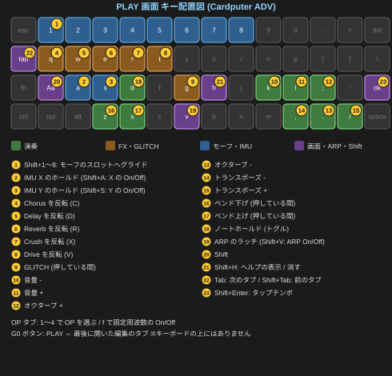

<p align="center"></p>

*[English version here / 英語版はこちら](README.md)*

**M5Stack Cardputer ADV** 向けの、**4 オペレータ FM ポリフォニック・シンセサイザー**のファームウェアです。PlatformIO + Arduino フレームワークで開発しています。Claude に私のアイデアを伝え、コーディングしてもらっています。

MORPHASE（*Morph + Phase*）は、MIDI キーボードで弾く 12 音ポリフォニックの FM シンセです。Cardputer は鍵盤ではなく、音色を作るエディタとコントローラとして働きます。本体を傾けたり、距離センサーに手をかざしたりして、音を動かすこともできます。

姉妹プロジェクトの [C.P.S. (CardPuter Synth)](https://github.com/oldtokage-collab/C.P.S.--Cardputer-SYHNTH--) とは、意図的に正反対の設計にしました。

| | C.P.S. | MORPHASE |
|---|---|---|
| 合成方式 | 減算方式（アナログ寄り） | 4 オペレータ FM + 波形モーフ |
| 発音数 | モノフォニック（単音） | **12 音ポリフォニック**（BLE 版は 10 音） |
| 弾くもの | Cardputer のキーボード | **MIDI キーボード** |
| Cardputer の役割 | 鍵盤 | 音色エディタ / コントローラ |

### 開発の経緯

C.P.S. の次は、和音を弾けるポリフォニックのシンセを作ると決めていました。ところが C.P.S. を作るなかで、Cardputer 本体のキーボードでは、いくつものキーを同時に正確に押すのが難しいことを実感しました。小さなキーは同時押しを取りこぼしやすく、和音を弾く鍵盤には向いていません。

そこで MORPHASE では、思い切って **Cardputer で演奏することをやめました。** 弾くのは MIDI キーボードに任せ、Cardputer は音色を作るエディタとコントローラに専念させます。キーボードの処理に使っていた余裕は、すべて音の処理に回しました。その分で、12 音のポリフォニック、14 種類のアルゴリズム、パッチモーフ、GLITCH、テルミンを載せ、「もっと面白い音を作れて、もっと面白く弾けるシンセ」を目指しました。

**名前の由来。** MORPHASE は *Morph*（変形する）と *Phase*（位相）を合わせた名前です。FM 音源は、波の位相を別の波で揺らして音色を作ります（DX7 などの FM 音源も、仕組みとしては位相の変調です）。MORPHASE ではさらに、そのオペレータの波形そのものが変形（モーフ）し、パッチからパッチへと音全体が移り変わっていきます。「位相を揺らし、形を変えていく」シンセ、という意味を込めました。

**BLE MIDI。** MIDI キーボードを前提にしたことで、Unit MIDI を持っていない人には遊んでもらえない、という壁ができてしまいました。そこで開発の最終盤に、iPhone / iPad などから Bluetooth で弾ける **BLE 版** を加えました。Bluetooth の仕組みはメモリと処理の余裕を大きく使うので、音を 2 つ減らす（12 → 10 音）ことと引き換えです。それでも、ケーブル 1 本も無しに、手元のスマートフォンやタブレットで MORPHASE を弾けるようになりました。

開発の様子は Reddit や私の [Twitter(X) アカウント](https://x.com/Tokagetchi)で公開・共有しています。

> **現状 100% バイブコーディングです！**
> AI の使用やバイブコーディングに抵抗がある方は申し訳ありません！

> **状態: v1.0（最初の正式公開版）**

---

## 取扱説明書

初めての方は**クイックスタートガイド**、機能の詳細を調べたいときは**リファレンスガイド**をご覧ください。PDF はオフラインでいつでも読めます。

| ガイド | 日本語 | English |
|---|---|---|
| クイックスタートガイド | [Markdown](docs/QuickStart_ja.md) ／ [PDF](docs/QuickStart_ja.pdf) | [Markdown](docs/QuickStart_en.md) ／ [PDF](docs/QuickStart_en.pdf) |
| リファレンスガイド | [Markdown](docs/Reference_ja.md) ／ [PDF](docs/Reference_ja.pdf) | [Markdown](docs/Reference_en.md) ／ [PDF](docs/Reference_en.pdf) |


---

## MORPHASE の主な特長

### FM シンセのエンジン

- **4 オペレータの FM 音源、14 種類のアルゴリズム**：4 オペレータ FM の定番の形を中心にした 8 種類に加え、フィードバックの位置が違う 6 種類（のこぎり波・うなり・金属の音向け）
- **波形のモーフ**：オペレータの波形は正弦波に固定ではなく、明るさの順に並んだ 8 つの波形（Sine → Squeeze → HalfSine → Parabolic → ESquare → Saw2 → ESaw → Square2）の間をなめらかに移り変わります。`GMorph` で 4 つまとめて動かせます
- **固定周波数のオペレータとピッチエンベロープ**：キック・タム・金物などの打楽器も作れます
- **12 音ポリフォニック**（BLE 版は 10 音）。モノ・レガート・グライドも

フィルターは意図的に載せていません。FM は音色をオペレータの側で作る方式なので、フィルターに使う処理の余裕を声の数に回しています。

### パッチモーフ：音から音へ

- 8 つのスロットに並べたパッチの間を、比率もエンベロープも FX もまるごと混ぜながら移っていきます
- ノブ・傾き・LFO で「位置」を動かす**チェーン**と、`Shift+1〜8` や MIDI のパッドで狙ったパッチへ滑っていく**グライド**の 2 通り
- 並べたチェーンは名前を付けて保存でき、MIDI のボタンで次々に切り替えられます


### GLITCH：わざと崩す

- 直前の音をくり返す・逆回し・ぶつ切り（Stutter / Reverse / Gate）
- 音色を一瞬飛ばす（Chaos）
- アルペジオの刻みを崩す（打ち直し・オクターブ跳び・逆行・休符）
- `g` を押している間だけ、常に、本体を傾けたぶんだけ、のどれでも起こせます

### テルミン（M5Stack Unit ToF4M 対応）

- 距離センサーに**手をかざして**音を動かします
- 手の距離で音色などを動かす `Mod` と、手の高さで 1 音を弾く楽器になる `Play` の 2 つのモード。`Play` では、なめらかな音程のほか、49 種類のスケールに合わせることもできます
- 鍵盤と同時に弾けます（左手で和音、右手でテルミン）

### 体で動かす

- **本体を傾けて**音色を変える（IMU。On にするだけで、たいていのパッチで効きます）
- MIDI コントローラーのノブ 4 つ・ボタン 4 つを、動かすだけで覚えさせる（MIDI Learn）

### アルペジエーター

- 5 つのパターン（Up / Down / UpDown / Random / AsPlayed）+ **STEP**：16 ステップに「押さえた和音の何番目の音か」を並べるので、和音を変えるとリズムはそのまま音だけが変わります
- ラッチ、スウィング、外部 MIDI クロックへの同期、パターンを 8 つ保存

### FX と、歪まない出力

- Crush・Chorus・Delay・Reverb・Drive。`q w e r t` で演奏しながら抜き差しできます
- 最後に出力のリミッター：大きな和音でも、波形を曲げずに音量だけを抑えます。**歪み系の FX（Drive・Crush）を使わなければ、MORPHASE は歪みません**

### すぐ鳴らせる 32 個のファクトリーパッチ

- 鍵盤・ベル・ベース・リード・パッド・ドラム・ノイズまで（一覧と「触りどころ」はリファレンスガイドの 14 章）

### 2 つの版

- 通常版（Unit MIDI）と、iPhone / iPad から Bluetooth MIDI でも弾ける BLE 版（動作を確かめたアプリ: [KeyPad](https://www.discodsp.com/jp/keypad/)）

---

## ハードウェア

| 項目 | 内容 |
|---|---|
| 対応デバイス | **M5Stack Cardputer ADV 専用**（ESP32-S3FN8、PSRAM なし） |
| MIDI | M5Stack **Unit MIDI（U187）** を本体の Grove 端子に接続。DIP スイッチ = **BYPASS**、Grove の 5V スイッチ = **5VOUT**。**BLE 版**は Bluetooth MIDI も受けられます |
| ストレージ | microSD（FAT32。パッチ・チェーン・ARP パターン・設定） |
| 傾き | 内蔵の IMU（X / Y 軸を変調に使う） |
| テルミン（任意） | M5Stack **Unit ToF4M**（VL53L1X）。LoRa Cap の Grove、または Unit MIDI の代わりに本体の Grove に接続 |
| 音を聴くもの | イヤホンがおすすめです（本体のスピーカーでは低い音がほとんど聞こえません） |

> **オリジナルの Cardputer（ADV でない方）には対応していません。**

---

## 2 つの版

同じソースから、2 つの版を作っています。どちらか 1 つを選んでください。パッチのファイルは両方で使えます。

| | 通常版 `MORPHASE_<版>.bin` | BLE 版 `MORPHASE_BLE_<版>.bin` |
|---|---|---|
| MIDI の入力 | Unit MIDI（DIN） | Unit MIDI（DIN）**と Bluetooth MIDI**（同時に使えます） |
| 同時に鳴らせる音 | 12 音 | 10 音 |
| 画面 | 16bit カラー | 8bit カラー（UI はテーマごとにほぼ 1 色なので、見た目は同じです） |

DIN の MIDI キーボードを Unit MIDI でつなぐなら**通常版**、iPhone / iPad / Mac / PC から Bluetooth で弾きたいときや Unit MIDI を持っていないときは**BLE 版**を選んでください。Bluetooth の仕組みはメモリを使い、音の処理と同じ CPU を分け合うので、その分を 2 音で払っています。Voices を 11 か 12 にしたパッチは、BLE 版では 10 音で鳴ります（ファイルの値はそのまま。ALGO タブには `12 (10)` と出ます）。

---

## インストール方法

### 方法 1 — M5Burner でインストール（一番簡単・おすすめ）

1. [M5Burner](https://docs.m5stack.com/en/uiflow/M5Burner) を公式サイトからダウンロード・インストールします
2. Cardputer ADV を USB-C でパソコンに接続します
3. M5Burner の中で「MORPHASE」を検索し、通常版か BLE 版を選びます
4. COM ポートを選び、「Burn」（書き込み）ボタンを押します
5. 書き込みが終わると、MORPHASE が起動します

### 方法 2 — Launcher FW 経由でのインストール

#### 方法 2a — OTA 機能を使う

1. Cardputer ADV で Launcher FW を起動します
2. OTA 機能から「MORPHASE」を検索します
3. 通常版か BLE 版を選び、ダウンロード・インストールします

#### 方法 2b — SD カードに手動でコピーする

1. [Releases](../../releases) ページから、最新の `MORPHASE_<版>.bin` か `MORPHASE_BLE_<版>.bin` をダウンロードします
2. `.bin` ファイルを SD カードの**ルート直下**にコピーします（サブフォルダに入れないでください）
3. SD カードを Cardputer ADV に挿し、Launcher FW のファイルブラウザで `.bin` を選んで書き込みます

`.bin` は bootloader + partitions + firmware を 1 つにまとめたファイルです。単一ファイルに対応したほかの書き込みツールでも、オフセット `0x0` に書き込めます。

### 方法 3 — ソースからビルド（PlatformIO）

1. [VSCode](https://code.visualstudio.com/) に **PlatformIO IDE** 拡張機能を入れます
2. このリポジトリをクローンまたはダウンロードし、フォルダを開きます
3. `platformio.ini` が自動で読み込まれ、初回のビルドで必要なライブラリがダウンロードされます
4. `pio run` で両方の版がビルドされます。環境名は `morphase`（通常版）と `morphase_ble`（BLE 版）です

```bash
pio run -e morphase -t upload
```

ビルドすると、`.pio/build/<環境名>/` に `firmware.bin`（アプリ本体だけ）と `merge.bin`（M5Burner などで使う統合バイナリ）ができます。

> **書き込みモードに入らない場合**：電源オフ → G0 ボタンを押しながら電源オン → G0 ボタンを離す

### 初めて起動したとき（共通）

microSD カードに `/MORPHASE` フォルダが作られ、**32 個のファクトリーパッチ**と 2 本のファクトリーのチェーンが書き込まれます（数秒かかります）。起動画面のあと、PLAY 画面が出ます。最初は `01_EPiano` が鳴ります。

SD カードが無くても初期の音で動きますが、何も保存されません。

---

## 操作方法

本体のキーボードはコントローラで、鍵盤ではありません。音は MIDI キーボードで弾きます。どの画面でも `Shift+H` で、その画面のキーの一覧が出ます。



### タブとカーソル

画面の上に `PLAY` `OP` `ALGO` `ARP` `LFO` `FX` `SET` のタブが並んでいます。

| キー | 内容 |
|---|---|
| `Tab` / `Shift+Tab` | 次のタブ / 前のタブ |
| `G0` ボタン | PLAY 画面と、最後に開いた編集のタブを行き来する |
| `;` / `.` | 項目を選ぶ（上 / 下） |
| `,` / `/` | 値を変える（1.5 秒押し続けると 10 倍の幅で動く） |
| `Enter` | 切り替え / 実行 / 決定。CC 番号の項目では MIDI Learn |
| `Shift+H` | ヘルプを出す / 消す |

### どの画面でも使えるキー

| キー | 内容 |
|---|---|
| `K` / `L` | 本体の音量を下げる / 上げる |
| `D` | ノートホールド（もう一度押すまで、押さえた音を伸ばす） |
| `Z` / `X` | 押している間、ピッチベンド（下げる / 上げる） |
| `A` / `S` | IMU の X / Y 軸の今の傾きを固定 / 解除 |
| `Shift+A` / `Shift+S` | IMU の X / Y 軸を On / Off（最初は Off） |
| `Shift+V` / `V` | ARP の On / Off / ラッチの On / Off |
| `Shift+Enter` | タップテンポ |
| `q` `w` `e` `r` `t` | Chorus / Delay / Reverb / Crush / Drive を一時的に反転 |
| `g` | 押している間、GLITCH |
| `Shift+1`〜`Shift+8` | モーフのスロット 1〜8 へグライド |

### PLAY 画面だけのキー

| キー | 内容 |
|---|---|
| `;` / `.` | オクターブを上げる / 下げる（−3〜+3） |
| `,` / `/` | トランスポーズを下げる / 上げる（−12〜+12 半音） |

### 各タブ

| タブ | 内容 |
|---|---|
| **PLAY** | 出力の波形、鳴っている音、変調・FX・GLITCH・モーフの状態、傾きのパッド |
| **OP** | オペレータ 1〜4（`1`〜`4` で選ぶ）: Morph・Ratio・Detune・Level・A/D/S/R・VelSns・KScl。`f` で固定周波数。A/D/S/R の行ではエンベロープのグラフ |
| **ALGO** | アルゴリズムの図、Feedback、GMorph、Volume、Voices、グライド、ピッチエンベロープ（PEnv の行ではそのグラフ） |
| **ARP** | パターン（Up / Down / UpDown / Random / AsPlayed / STEP）・テンポ・刻み・スウィング・ゲート・オクターブ・ラッチ・クロック同期 |
| **LFO** | 波形・速さ・深さ・Delay・行き先。右に波形と今の位置 |
| **FX** | 5 つのパッド。`,` `/` でパッド、`Enter` で On / Off、`.` でパラメータ、`Tab` で戻る |
| **SET** | Patch（保存・読み込み・モーフ・チェーン・Factory）/ Display / MIDI / IMU / Theremin / Glitch / ARP Pattern / Info |


変調が働いている値には印が付きます: `*` = IMU（傾き）、`~` = LFO、`^` = テルミン。

それぞれの項目の範囲・初期値・使い方は、リファレンスガイドにまとめています。

---

## 信号経路

```
ボイス 1〜12（アルゴリズムに従ってつないだ OP1〜OP4）
    │  ◄── ピッチエンベロープ / グライド / ベンド / IMU・LFO・CC・テルミンの変調
    ▼
足し合わせ（ミックスバス）
    │
    ▼
Crush → Chorus → Delay → Reverb → GLITCH → Drive
    │
    ▼
音量 → 出力のリミッター（音量だけを下げる。波形は曲げない）
    │
    ▼
出力（スピーカー / ヘッドホン）
```

- エフェクトは `Mix = 0` で Off、そのときの処理はゼロです
- すべての音が消えても、Delay や Reverb の余韻は鳴り続けます
- GLITCH の Stutter / Reverse は、Delay のラインを録音テープとして使います

---

## BLE MIDI（BLE 版）

BLE 版は、**MORPHASE** という名前の Bluetooth MIDI 機器として見えます。MIDI の入力だけで、DIN の MIDI と同時に使えます。ノート・ベロシティ・ピッチベンド・すべての CC と MIDI Learn・サステイン・プログラムチェンジ・MIDI クロックは、DIN と同じように動きます。ただし、テンポの同期は DIN の方が安定します（BLE は 10ms 前後ごとにまとめて届くため）。

**つなぎ方。** BLE MIDI は、**アプリの中から**つなぎます。スマートフォンの「設定」の Bluetooth の画面からではありません（そこでペアリングしても、MIDI としてはつながりません）。

- **iPhone / iPad**: Bluetooth MIDI の接続画面を持つアプリで **MORPHASE** を選びます。動作を確かめたアプリ: [KeyPad](https://www.discodsp.com/jp/keypad/)
- **Mac**: Audio MIDI 設定 → ウインドウ → MIDI スタジオを表示 → Bluetooth のボタン → MORPHASE の「接続」
- **Windows / Android**: BLE MIDI の機器に対応したアプリや DAW を使ってください


PLAY 画面の名前の右に、接続を待っている間は暗い `b`、つながっている間は明るい `B` が出ます。演奏中に接続が切れると、すべての音が止まり、次の接続を待ちます。`SET > MIDI > BLE` で On / Off できます（再起動のあとに反映）。

**つながらないとき。** MORPHASE は、MORPHASE 専用の Bluetooth のアドレスを使います。ほかのファームウェアがスマートフォンに残したペアリングの情報の影響は受けにくいのですが、それでもつながらない場合は、スマートフォンの Bluetooth の設定で古い Cardputer / MORPHASE の登録を解除し、Bluetooth を一度オフにしてオンに戻してから、アプリでつなぎ直してください。

---

## テルミン

M5Stack **Unit ToF4M**（距離センサー VL53L1X）で、手をコントローラにします。設定は `SET > Theremin` です（本体の設定で、パッチには保存されません）。

| 端子 | 挿すもの |
|---|---|
| 本体の Grove（G1 / G2） | Unit MIDI。DIN の MIDI はここだけを読みます |
| LoRa Cap の Grove | ToF、`Bus` = `Cap`（既定・おすすめ）。DIN の MIDI とテルミンを同時に使えます |
| `Bus` = `Grove` | LoRa Cap が無い場合: ToF を本体の Grove に挿します。**テルミンが On の間、DIN の MIDI は使えません**（BLE 版なら Bluetooth MIDI と組み合わせられます） |

- **Mod**: 手の距離が変調の入口になります（近いほど深い）。鍵盤で弾いている和音の音色を、手で動かせます
- **Play**: テルミン専用の 1 声が今のパッチの音で鳴り、手の距離で音程、本体の傾きで音量が変わります。鍵盤で使える声は 1 つ減ります


画面の一番下に、今の距離とセンサーの状態が出るので、手をかざしたまま `Near` / `Far`（使う距離の範囲）を決められます。

---

## パッチとファイル

```
/MORPHASE/settings.json        本体の設定（起動時に戻す）
/MORPHASE/current.json         編集中の音
/MORPHASE/Patch/<名前>.json    パッチ（最大 128）
/MORPHASE/Chain/<名前>.txt     保存したモーフのチェーン
/MORPHASE/Pattern/0..7.json    ARP の STEP パターン
/MORPHASE/morph.txt            今のモーフのスロット（パッチの名前を 1 行に 1 つ）
```

- パッチは「音」を運びます（オペレータ・アルゴリズム・フィードバック・GMorph・音量・声数・グライド・ピッチエンベロープ・LFO・IMU の行き先と深さ・FX）。ARP・MIDI・テルミン・GLITCH・画面の設定は本体の設定です
- ファクトリーパッチ（`01_EPiano`〜`32_Drone`）は、一覧の先頭に必ず並ぶので、プログラムチェンジ 0〜31 の番号は変わりません
- ファクトリーパッチは本体から上書きできません（Save は新しい名前を聞きます）。`SET > Patch > Factory` で、いつでも元に戻せます
- ファイルはテキストなので、ほかの人と共有できます

---

## 既知のハードウェアの癖：キーボードの凍結（TCA8418）

Cardputer ADV のキーボードのチップ（TCA8418）は、特に速く打ったあとなどに、まれに反応しなくなることがあります。チップの性質で、ソフトウェアからはリセットできません。**MORPHASE はこれを見つけて、30 秒ほどで自動的に再起動して戻ります。** MORPHASE ではキーボードを演奏に使わないので、起きることは少ないはずです。

---

## プロジェクト構成

```
MORPHASE/
├── platformio.ini       ビルド設定（環境 morphase / morphase_ble）
├── merge_bin.py         ビルド後に merge.bin を作るスクリプト
├── docs/                説明書（日本語・英語、Markdown・PDF）と画像
├── tools/               PC で音を書き出す道具、説明書の生成スクリプトなど
└── src/
    ├── main.cpp         setup / loop、全画面共通のキー、IMU、ウォッチドッグ
    ├── config.h         定数・列挙・構造体
    ├── fm.*             波形の表、モーフ、エンベロープ、14 のアルゴリズム
    ├── voice.*          声の割り当て、グライド、変調、音の処理のタスク
    ├── fx.*             Crush / Chorus / Delay / Reverb / Drive / 出力のリミッター
    ├── glitch.*         GLITCH
    ├── morph.*          パッチモーフ（チェーンとグライド）
    ├── arp.*            アルペジエーターと STEP パターン
    ├── midi.*           MIDI の受信、MIDI Learn、CC・スイッチ
    ├── ble_midi.*       Bluetooth MIDI（BLE 版だけ）
    ├── theremin.*       テルミン（Unit ToF4M）
    ├── patch.*          SD の保存・読み込み、ファクトリーパッチ
    └── ui_*             画面、キー、メニュー、ヘルプ
```

---

## 依存ライブラリ

PlatformIO が自動で管理します（`platformio.ini` で版を固定しています）。

| ライブラリ | バージョン | 使う版 |
|---|---|---|
| `m5stack/M5Cardputer` | ≥ 1.1.1 | 両方 |
| `m5stack/M5Unified` | ≥ 0.2.8 | 両方 |
| `m5stack/M5GFX` | ≥ 0.2.10 | 両方 |
| `pololu/VL53L1X` | ≥ 1.3.1 | 両方（テルミン） |
| `h2zero/NimBLE-Arduino` | 2.5.1 | BLE 版 |

プラットフォームは `espressif32@6.7.0`（Arduino-ESP32 2.0.16）です。`SD` と `SPI` は Arduino-ESP32 のコアに含まれています。

---

## 既知の制限事項

- オリジナルの Cardputer（ADV でない方）には対応していません
- 本体のキーボードでは演奏できません（MIDI キーボードが必要です）
- アルゴリズムの違うパッチどうしのモーフは、途中で音が切り替わります
- チェーンの読み込みでは、0.1〜0.2 秒ほど画面と MIDI の処理が止まります（音は止まりません）
- 速い LFO では、画面の点がゆっくり・逆に動いて見えることがあります（LFO そのものは設定どおりです）
- BLE 版は 10 音、画面は 256 色、MIDI クロックは DIN より揺れます。動作を確かめた機器は iPhone・iPad（アプリ KeyPad）です
- ステップシーケンサー・ソングモードは載せていません（代わりに STEP のアルペジエーターがあります）

---

## ライセンス

**CC BY-NC-SA 4.0**（表示 - 非営利 - 継承）。全文は [LICENSE](LICENSE) を参照

- **表示（BY）**：利用の際はクレジット表記をお願いします
- **非営利（NC）**：商用利用はできません
- **継承（SA）**：改変・二次利用したものを公開する場合、同じ CC BY-NC-SA 4.0 で公開してください

詳細は [https://creativecommons.org/licenses/by-nc-sa/4.0/deed.ja](https://creativecommons.org/licenses/by-nc-sa/4.0/deed.ja) をご覧ください。

作: [@Tokagetchi](https://x.com/Tokagetchi)、コード: Claude（Anthropic）。[M5Unified / M5GFX / M5Cardputer](https://github.com/m5stack)、[Pololu VL53L1X](https://github.com/pololu/vl53l1x-arduino)、[NimBLE-Arduino](https://github.com/h2zero/NimBLE-Arduino) と PlatformIO の上に作っています。

自由に使用・改変・共有してください（商用利用を除く）。面白い音ができたら、ぜひコミュニティにシェアしてください！
