# MORPHASE リファレンスガイド

このガイドは、MORPHASE のすべての画面・項目・キーを説明するものです。初めての方は、先に「クイックスタートガイド」で一通り触ってみてください。

画面に出る名前（タブ名・項目名・パッチ名）は、画面の表記のまま英語で書いています。

## 目次

1. 基本操作（PLAY 画面）
2. MORPHASE の音の仕組み
3. OP タブ
4. ALGO タブ
5. ARP タブ
6. LFO と IMU（変調）
7. FX タブ
8. GLITCH
9. パッチ
10. パッチモーフ
11. MIDI
12. BLE MIDI（BLE 版）
13. SETTING
14. ファクトリーパッチ一覧
15. Info 画面
16. 困ったとき・既知の制限

---

## 1. 基本操作（PLAY 画面）

### 1.1 タブ

画面の上に `PLAY` `OP` `ALGO` `ARP` `LFO` `FX` `SET` のタブが並んでいます。

| 操作 | 内容 |
|---|---|
| `Tab` / `Shift+Tab` | 次のタブ / 前のタブ |
| `G0` ボタン | PLAY 画面と、最後に開いた編集のタブを行き来する |
| `Shift+H` | その画面のヘルプを出す / 消す |

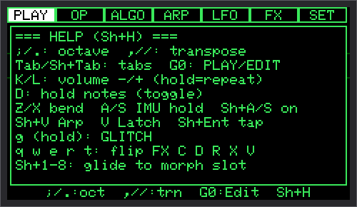

各タブの中では、`;` `.` で項目を選び、`,` `/` で値を変えます。値のキーを 1.5 秒押し続けると、10 倍の幅で動きます。

### 1.2 どの画面でも使えるキー

| キー | 内容 |
|---|---|
| `K` / `L` | 本体の音量を下げる / 上げる（押し続けると続けて変わる）。3 秒後に保存 |
| `D` | ノートホールド。押さえた音を、もう一度 `D` を押すまで伸ばす |
| `Z` / `X` | 押している間、ピッチベンド（下げる / 上げる）。幅は `SET > MIDI > BendRng` |
| `A` / `S` | IMU の X / Y 軸の今の傾きを固定（ホールド）/ 解除 |
| `Shift+A` / `Shift+S` | IMU の X / Y 軸を On / Off |
| `Shift+V` | ARP の On / Off |
| `V` | ARP のラッチの On / Off |
| `Shift+Enter` | タップテンポ（2〜4 回たたく） |
| `q` `w` `e` `r` `t` | Chorus / Delay / Reverb / Crush / Drive を一時的に反転（7.4） |
| `g` | 押している間、GLITCH（8 章） |
| `Shift+1`〜`Shift+8` | モーフのスロット 1〜8 へグライド（10.3） |

### 1.3 PLAY 画面だけのキー

| キー | 内容 |
|---|---|
| `;` / `.` | オクターブを上げる / 下げる（-3〜+3） |
| `,` / `/` | トランスポーズを下げる / 上げる（-12〜+12 半音） |

オクターブとトランスポーズは、入ってきた MIDI のノートすべてにかかります。3 秒後に保存されます。

### 1.4 PLAY 画面の見方

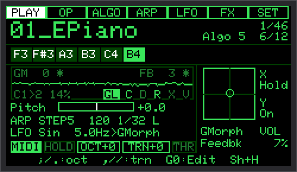

| 場所 | 内容 |
|---|---|
| 一番上 | パッチの名前、一覧の何番目か（一覧に無い編集中の音は `edit`）、アルゴリズム、鳴っている音の数 / 使える声の数（モノのパッチは `mono`）。BLE 版は名前の右に `b`（接続待ち、暗い）/ `B`（接続中） |
| ノートの列 | ARP が Off のときは声ごとの枠に鳴っている音の名前。ARP が On のときは、ARP が使っている和音（最後に鳴らした音が点く） |
| スコープ | 出力の波形。音が無いときは `- silent -` |
| スコープの上の文字 | 左上 `GM`（GMorph の今の値）、右上 `FB`（Feedback）、右下 `C D R X V`（鳴っている FX が点く）、`GL`（GLITCH: 暗い = Off、明るい = On、反転 = 今まさに崩れている）、左下にモーフの状態（`C1>2 45%` = チェーンが動いている、`C paused` = 一時停止、`C off` = チェーンが Off、`M>3 45%` = グライド中）。どれも `SET > Display` で消せる |
| `Pitch` | ピッチベンドとピッチの変調のバー（半音） |
| ARP の行 | `ARP Up 120 1/16 L`（パターン・テンポ・刻み・ラッチ）。外部クロックに合わせているときは `CLK` |
| LFO の行 | 波形・速さ・行き先。動いているときは `~` |
| 下の段 | `MIDI`（受信すると点く。Grove のテルミンで DIN を止めているときは `-DIN`）、`HOLD`、`OCT`・`TRN`（0 以外で塗りつぶし）、`THR` / `THP`（テルミンが On で Mod / Play） |
| 右の列 | 傾きのパッド（点が今の傾き、中が空の点はキャリブレーション済み）、X / Y の `On` / `Off` / `Hold`、X / Y の行き先、本体の音量 `VOL` |

### 1.5 行き先の印

変調が働いている値の横には、印が付きます。

| 印 | 動かしているもの |
|---|---|
| `*` | IMU（本体の傾き） |
| `~` | LFO |
| `^` | テルミン（Mod モード） |

---

## 2. MORPHASE の音の仕組み

### 2.1 4 オペレータ FM

MORPHASE の音は、**4 つのオペレータ（OP1〜OP4）**でできています。オペレータは、1 つの波形を鳴らす小さな発振器です。

- **キャリア**: 耳に聞こえる音を出すオペレータ
- **モジュレータ**: キャリアの波形を速く揺らして（変調して）、音色を変えるオペレータ。耳には直接聞こえない
- **Ratio（比率）**: 弾いた音の何倍の高さで鳴るか。キャリアの Ratio は音の高さ、モジュレータの Ratio は音色（倍音の並び）を決める
- **Level**: キャリアなら音の大きさ、モジュレータなら変調の深さ（=明るさ・複雑さ）
- **Feedback**: オペレータが自分自身を変調すること。ざらつき・のこぎり波のような音になる

どのオペレータがどれを変調するかの組み合わせを **アルゴリズム** と呼びます（4 章）。

### 2.2 8 つの波形とモーフ

各オペレータの波形は、明るさの順に並んだ 8 つの波形の間を、なめらかに移り変わります（`Morph` 0〜100%）。

```
Sine → Squeeze → HalfSine → Parabolic → ESquare → Saw2 → ESaw → Square2
（なめらか）                                                  （とがった）
```

- **OP タブの `Morph`**: そのオペレータだけの波形
- **ALGO タブの `GMorph`**: 4 つのオペレータの波形を、まとめてずらす（各 OP の Morph に足される）

### 2.3 FM の音作りのコツ（ファクトリーパッチ作りで分かったこと）

| コツ | 理由 |
|---|---|
| **非整数の比率のモジュレータは、1 つのキャリアに 1 つまで** | 2 つ以上あると、和と差の成分が爆発的に増え、うなりや「じゅるじゅる」した濁りになる |
| **非整数の比率は、1 つの格子（例: 0.5 刻み）にそろえる** | ペアの中でも、側帯波が弾いた音より下に落ちることがある（例: キャリア 2.76・モジュレータ 1.41 → 0.06 倍 = 16Hz のうなり） |
| **変調の深さと音程感は比例しない** | FM では、深さによってキャリアの基音の強さが増えたり減ったりをくり返す。Level 40〜45 あたりで、かえって音程が消えることがある（31_NoiseSwl の調整で確認） |
| **ノイズを作るなら、モジュレータは低く深く** | 側帯波が密に並び、柔らかいノイズの帯になる。高い音程だけで深く変調すると「たくさんの金属の音」になる |
| **近い音程どうしは、低い差音を作る** | 金物の音で、近い固定周波数を重ねると、低い「芯」が出る（HiHat の調整で確認） |
| **立ち上がりで明るくなる形は、ブラスに聞こえる** | 弦や声の音では、モジュレータのエンベロープを立ち上がりから一定にする（18_Strings で確認） |
| **波形を ESaw（Morph 85 以上）まで上げると、高い音でざらつく** | 波形の中に急な段差があり、折り返し雑音が出る。のこぎり波らしさは 78 くらいまでで十分 |
| **ポリの和音は音が足し算になる** | 4 音で 1 音の 3〜4 倍の大きさになる。大きくしすぎても、最後の出力のリミッターが音量を抑える（7.5） |

---

## 3. OP タブ

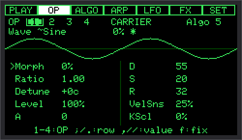

数字キー `1`〜`4` で、編集するオペレータを選びます。一番上の行に、そのオペレータの役割（`CARRIER` / `MODULATOR`、フィードバックがかかるなら `+FB`）とアルゴリズムが出ます。2 行目には今の波形の名前と Morph の値（変調込み）が出ます。

| 項目 | 範囲 | 内容 |
|---|---|---|
| `Morph` | 0〜100% | 波形（2.2）。印 OpMorph |
| `Ratio` | 0.25〜16.00 | 弾いた音の何倍で鳴るか（0.01 刻み）。印 OpRatio |
| `Fixed` | 1Hz〜約 8.4kHz（半音刻み） | 固定周波数のとき、`Ratio` の代わりに出る。`220Hz A3` のように表示 |
| `Detune` | -50〜+50 セント | ほんの少し高さをずらす（うなりを作る）。印 OpDetun |
| `Level` | 0〜100% | 大きさ / 変調の深さ。0 で、そのオペレータは止まる。印 OpLevel |
| `A` | 0〜100 | アタック（立ち上がりの時間） |
| `D` | 0〜100 | ディケイ（最大から S まで下がる時間） |
| `S` | 0〜100 | サステイン（押している間のレベル） |
| `R` | 0〜100 | リリース（離してから消えるまでの時間） |
| `VelSns` | 0〜100% | 弾く強さでレベルが変わる量。モジュレータで使うと、強く弾くほど明るくなる |
| `KScl` | 0〜100% | キースケーリング。モジュレータのレベルを、C4 より上で 1 オクターブごとに下げる（100% で半分）。高い音がうるさくなりすぎるのを防ぐ |

### 3.1 固定周波数（`f`）

`f` を押すと、選んでいるオペレータが **Ratio ↔ Fixed** で切り替わります。Fixed のオペレータは、鍵盤・グライド・ピッチベンドに関係なく、同じ高さで鳴ります（ピッチエンベロープだけはかかる）。打楽器のアタックや金物の音に使います。固定のオペレータは、一番上の番号の色と、2 行目の右の `FIX` で分かります。Ratio に戻すと、元の Ratio の値に戻ります。

### 3.2 エンベロープのグラフ

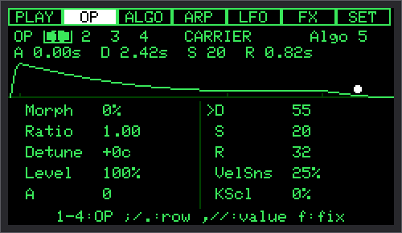

カーソルが `A` `D` `S` `R` の行にあるときは、波形の代わりにエンベロープのグラフが出て、2 行目に実際の時間（例: `A 0.03s  D 1.30s  S 40  R 0.45s`）が出ます。

- 時間: A は `0.002 + (値/100)² × 3` 秒、D と R は `0.002 + (値/100)² × 8` 秒。値の 2 乗なので、小さな値ほど細かく決められます
- 曲線は、音を出す処理と同じ式で描いています（グラフと音はずれません）
- 横の幅は時間に合わせていますが、短い A・D・R も見えるように最小の幅を持たせ、S（押している間）は全体の 1/4 の固定の幅です。正確な時間は上の数字で見てください
- 鍵盤を押すと、**最後に弾いた音**の今の位置が白い点で進みます（テルミンの音は対象外）
- リリースは、実際には「離した瞬間のレベル」から下がります（グラフは S から描いています）

---

## 4. ALGO タブ

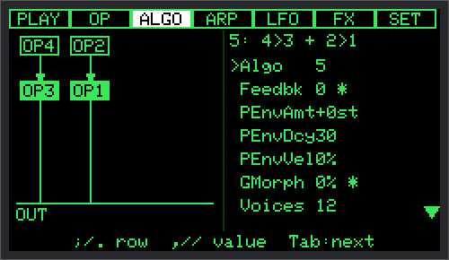

左にアルゴリズムの図、右に項目の一覧（7 行ずつスクロール）が出ます。図の塗りつぶした箱がキャリア、枠だけの箱がモジュレータ、`FB` の印がフィードバックのかかるオペレータです。Level 0 のオペレータは薄い色になります。

| 項目 | 範囲 | 内容 |
|---|---|---|
| `Algo` | 1〜14 | アルゴリズム（4.1） |
| `Feedbk` | 0〜100 | フィードバックの量。音が大きく変わるのは 0〜25 あたり。印 Feedbk |
| `PEnvAmt` | -48〜+48 半音 | ピッチエンベロープの深さ（4.2）。印 PEnvAmt |
| `PEnvDcy` | 0〜100 | ピッチエンベロープが戻る時間（D と同じ時間の決まり） |
| `PEnvVel` | 0〜100% | 弾く強さで深さが変わる量 |
| `GMorph` | 0〜100% | 4 つのオペレータの波形をまとめてずらす（2.2）。印 GMorph |
| `Voices` | 1〜12（BLE 版は 1〜10） | 同時に鳴らせる音の数。1 = モノ |
| `Glide` | 0〜1000ms | 音程が次の音へ滑っていく時間（ポルタメント）。印 Glide |
| `GlMode` | Always / Legato | Always = 毎回前の音から滑る、Legato = 前の鍵盤を押したまま次を弾いたときだけ滑る |
| `GlideOn` | On / Off | グライドを使うか |

BLE 版で 11〜12 声のパッチを読み込むと、`Voices` は `12 (10)` のように表示されます（パッチの値はそのまま、鳴るのは 10 声まで）。

### 4.1 14 のアルゴリズム

`>` は「変調する」、`+` は「並べて鳴らす」です。

| # | 名前 | つなぎ方 | フィードバックの位置 | 向いている音 |
|---|---|---|---|---|
| 1 | 4>3>2>1 | 直列 | OP4 | 深い変調、金属・ノイズ |
| 2 | (4,3)>2>1 | 3 と 4 が 2 を、2 が 1 を変調 | OP4 | ブラス、リード |
| 3 | 4>2>1+3>1 | 4>2>1 と 3>1 | OP4 | クラビ、複雑な音色 |
| 4 | (4,3,2)>1 | 3 つで 1 つのキャリアを変調 | OP4 | ベース、キック |
| 5 | 4>3 + 2>1 | 2 つのペア | OP4 | E.Piano、ベル、パッド |
| 6 | 4>3>2 + 1 | 3 段の直列 + 1 つのキャリア | OP4 | スネア（皮 + 響き線） |
| 7 | 4>(3,2,1) | 1 つのモジュレータで 3 つのキャリア | OP4 | パッド、加算合成風 |
| 8 | 1 2 3 4 | 4 つともキャリア | OP4 | オルガン（ドローバー） |
| 9 | SerSaw | 4>3>2>1 | **OP1**（キャリア） | のこぎり波のリード |
| 10 | Growl | 4>3>2>1 | **OP2** | うなるベース |
| 11 | DualFB | 4>3 + 2>1 | **OP4 と OP2**（別々） | 金属、厚いペア |
| 12 | StkSaw | 3>2>1 + 4 | OP4 | のこぎり波 + 別の音 |
| 13 | Pair+2 | 2>1 + 3 + 4 | **OP2** | ペア + 2 つのキャリア |
| 14 | Diamond | 4>(3,2)>1 | OP4 | ゴング、複雑な倍音 |

**アルゴリズムが同じパッチどうしは、モーフでなめらかにつながります**（10 章）。

### 4.2 ピッチエンベロープ

音の出始めに、音程を `PEnvAmt` だけずらして、`PEnvDcy` の時間で元の高さへ戻します（キックやタムの「ドゥン」、レーザーのような音）。固定周波数のオペレータにもかかります。レガート（モノで押さえたまま次を弾く）のときは、かけ直しません。

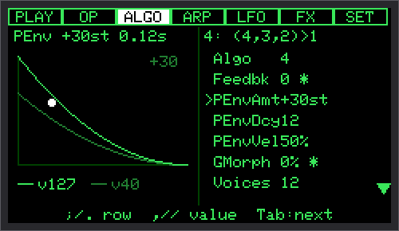

カーソルが `PEnvAmt` `PEnvDcy` `PEnvVel` の行にあるときは、図の代わりにピッチエンベロープのグラフが出ます。**濃い線がベロシティ 127、薄い線がベロシティ 40** のときの形で、`PEnvVel` を上げると 2 本の差が広がります。鍵盤を押すと、最後に弾いた音の今の位置が白い点で進みます。

---

## 5. ARP タブ

アルペジエーター（押さえた和音を、自動で分散和音として鳴らす機能）です。

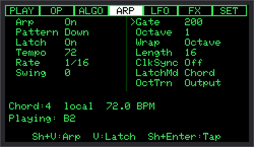

| 項目 | 範囲 | 内容 |
|---|---|---|
| `Arp` | On / Off | `Shift+V` と同じ |
| `Pattern` | Up / Down / UpDown / Random / AsPlayed / STEP | 鳴らす順。AsPlayed は押した順、STEP は 5.1 |
| `Latch` | On / Off | `V` と同じ。指を離しても和音を保持 |
| `Tempo` | 40〜300 BPM | 印 ArpTmpo |
| `Rate` | 1/4 / 1/8 / 1/8T / 1/16 / 1/16T / 1/32 | 1 ステップの長さ |
| `Swing` | -50〜+50 | 0 = ずらさない。+ = あとノリ（裏の音を遅らせる。+50 で 2:1 のはね）、- = 前ノリ（裏の音を早める。-50 で同じ量だけ早く）。はねは鳴らしたステップの順に「表・裏」と付くので、和音の音の数に関係なく崩れない。印 ArpSwng |
| `Gate` | 10〜200% | 音の長さ。100% を超えると前の音と重なる |
| `Octave` | 1〜4 | 何オクターブにわたって鳴らすか |
| `Wrap` | Rest / Wrap / Octave | STEP で、和音の音の数より大きい番号のときの扱い（休符 / 先頭へ戻る / 1 オクターブ上の同じ音） |
| `Length` | 1〜16 | STEP のステップ数 |
| `ClkSync` | On / Off | MIDI クロックを受けているとき、テンポをそれに合わせる |
| `LatchMd` | Add / Chord | Add = 押した音が順に加わる（もう一度押すと抜ける）、Chord = 全部離したあとに押した音で新しい和音 |
| `OctTrn` | Input / Output | オクターブ・トランスポーズを、入ってくる音にかける / ARP が出す音にかける |

初期値: Up / 120 BPM / 1/16 / Swing 0 / Gate 80% / Octave 1 / Wrap Octave / Length 16 / LatchMd Add / OctTrn Input。

### 5.1 STEP パターン

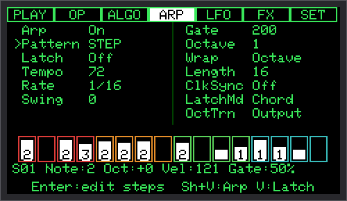

16 ステップのパターンで、各ステップは「音程」ではなく「**押さえている和音の何番目の音か**」（1〜8 か Off）、オクターブ、ベロシティ、ゲートを持ちます。和音を変えると、同じリズムのまま音が変わります。

| 操作 | 内容 |
|---|---|
| `Pattern` を STEP にして `Enter` | ステップの表に入る |
| `,` / `/` | ステップを選ぶ |
| `;` / `.` | 項目（音・オクターブ・ベロシティ・ゲート）を選ぶ |
| `1`〜`8` / `0` | 和音の何番目か / Off |
| `Shift+,` / `Shift+/` | 値を変える |
| `Enter` | 一覧に戻る |

パターンは 8 つまで保存できます（`SET > ARP Pattern`、13.7）。MIDI の 1 つの CC から 8 つ続けて割り当てると、パッドで直接選べます（`SET > MIDI > PtnBase`）。

ARP を崩す機能（ARP グリッチ）は 8 章にあります。

---

## 6. LFO と IMU（変調）

### 6.1 LFO タブ

LFO（ゆっくり繰り返す揺れ）は、すべての声で 1 つを共有します。

| 項目 | 範囲 | 内容 |
|---|---|---|
| `Wave` | Sine / Triangle / Saw / Square / S&H | 揺れの形（S&H = ランダムな段） |
| `Rate` | 0.1〜20.0Hz | 速さ |
| `Depth` | 0〜100% | 深さ。0 で止まる |
| `Target` | Off / 行き先の一覧（6.3） | 何を揺らすか。制御系（ArpTmpo など）は選べない |
| `Delay` | 0〜2000ms | 何も鳴っていないところから弾いたとき、揺れが入ってくるまでの時間（徐々に深くなる） |

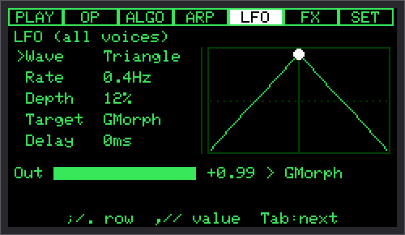

右側に揺れの形と、今の位置の点が出ます。下の行は今の出力の値と行き先です。

> 画面の描き直しは 1 秒に約 16 回なので、`Rate` が速いと（4Hz くらいから、8Hz を超えるとはっきり）、点がゆっくり動いたり逆に回ったりして見えることがあります（映画で車輪が逆に回って見えるのと同じです）。LFO そのものは設定どおりの速さで動いています。

LFO はプラスとマイナスの両方に揺れます。行き先の値は、パッチの値を中心に上下します。

### 6.2 IMU（本体の傾き）

Cardputer ADV の傾きのセンサーで、値を動かします。

- `Shift+A` / `Shift+S` で X 軸（左右）/ Y 軸（前後）を On にします。**初期状態は Off** です
- 行き先と深さは**パッチごと**の設定です。新しいパッチと、傾きの設定を持たないファクトリーパッチは、**X = GMorph 50%、Y = Feedbk 50%** で、On にするだけで音色が動きます（いっぱいに傾けると全範囲）
- GMorph・Feedbk・OpMorph・PtchMrph・GlProb のように、値が端にある行き先は、どちらに傾けても同じ向きに動きます。Pitch などは、傾けた向きで上下します
- 制御系も選べます。ArpTmpo・ArpSwng・ArpGate は、傾けた向きで設定値から増減します。Glide は、どちらに傾けても設定値から長くなる向きにだけ動きます（最大 +1000ms）

IMU の設定は `SET > IMU`（13.4）にまとまっています。

### 6.3 変調の行き先の一覧

行き先を選んでいる行（IMU の XTarget / YTarget、LFO の Target、ノブのスロットの `n Tgt`、テルミンの Target）では、画面の一番下に一言の説明が出ます。

| 名前 | 動かすもの | LFO | IMU / ノブ / テルミン |
|---|---|---|---|
| `GMorph` | 4 つの OP の波形（1 つのパッチの中の音色の変化） | ○ | ○ |
| `Feedbk` | フィードバックの量（ざらつき・のこぎり波寄りに） | ○ | ○ |
| `Pitch` | 音程（半音） | ○ | ○ |
| `Volume` | パッチの音量 | ○ | ○ |
| `OpMorph` | 選んでいる 1 つの OP の波形 | ○ | ○ |
| `OpLevel` | 選んでいる OP の大きさ（モジュレータなら明るさ） | ○ | ○ |
| `OpRatio` | 選んでいる OP の比率（音色・音程） | ○ | ○ |
| `OpDetun` | 選んでいる OP のデチューン（うなり） | ○ | ○ |
| `ArpTmpo` / `ArpSwng` / `ArpGate` | ARP のテンポ / スウィング / ゲート | — | ○ |
| `Glide` | 音程のグライドの時間 | — | ○ |
| `ChDepth` / `ChMix` | Chorus の深さ / 量 | ○ | ○ |
| `DlFdbk` / `DlMix` | Delay のくり返し / 量 | ○ | ○ |
| `RvSize` / `RvMix` | Reverb の広さ / 量 | ○ | ○ |
| `CrBits` / `CrDown` / `CrMix` | Crush のビット数 / 間引き / 量 | ○ | ○ |
| `DrAmt` / `DrMix` | Drive の強さ / 量 | ○ | ○ |
| `PtchMrph` | チェーンの位置（パッチからパッチへ、10 章） | ○ | ○ |
| `GlProb` | GLITCH の起きる確率（8 章） | ○ | ○ |
| `PEnvAmt` | ピッチエンベロープの深さ | ○ | ○ |

- **`Op…` の行き先は、OP タブで選んでいるオペレータ**に効きます（数字キー 1〜4）
- **FX の行き先は、その FX の Mix が 0（Off）だと効きません**
- 名前が似ていますが、**`GMorph`（波形）・`OpMorph`（1 つの OP の波形）・`PtchMrph`（パッチからパッチへ）は別物**です

---

## 7. FX タブ

### 7.1 考え方

**MORPHASE は、歪み系の FX（Drive・Crush）を使わなければ歪みません。**

- **Drive** は、歪みを**足す**ための道具です（音として使う）
- 音量が大きすぎるときは、一番最後の**出力のリミッター**が、波形を曲げずに**音量だけを下げて**、割れを防ぎます（7.5）

### 7.2 信号の流れ

```
声（最大 12、BLE 版 10）→ Crush → Chorus → Delay → Reverb → GLITCH → Drive → 音量 → 出力のリミッター → 出力
```

### 7.3 パッドとパラメータ

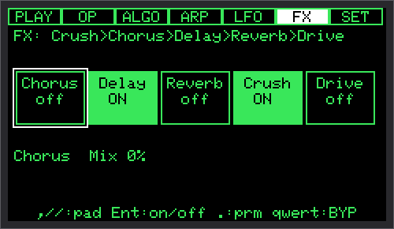

5 つのパッドが、キーの順（Chorus / Delay / Reverb / Crush / Drive）に並んでいます。**Mix が 0 なら Off** で、処理の負荷もかかりません。

| 操作 | 内容 |
|---|---|
| `,` / `/` | パッドを選ぶ |
| `Enter` | On / Off（On にすると Mix が既定値に戻る） |
| `.` | パラメータの画面へ |
| `Tab`（パラメータの画面で） | パッドに戻る |

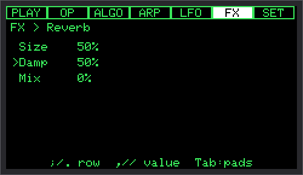

| FX | パラメータ | 範囲 | 初期値 | On にしたときの Mix |
|---|---|---|---|---|
| Chorus（揺れと広がり） | `Rate` / `Depth` / `Mix` | 0.1〜5.0Hz / 0〜20ms / 0〜100% | 0.8Hz / 8ms / 0 | 40% |
| Delay（やまびこ） | `Time` / `Fdbk` / `Mix` | 50〜600ms / 0〜90% / 0〜100% | 300ms / 35% / 0 | 30% |
| Reverb（残響） | `Size` / `Damp` / `Mix` | 0〜100% ×3 | 50 / 50 / 0 | 35% |
| Crush（デジタルの粗さ） | `Bits` / `Down` / `Mix` | 1〜16 / 1〜32x / 0〜100% | 8 / 4x / 0 | 100% |
| Drive（歪み） | `Amount` / `Mix` | 1.0〜5.0x / 0〜100% | 2.0x / 0 | 100% |

### 7.4 FX ショートカット（`q` `w` `e` `r` `t`）

| キー | FX | PLAY の文字 |
|---|---|---|
| `q` | Chorus | `C` |
| `w` | Delay | `D` |
| `e` | Reverb | `R` |
| `r` | Crush | `X` |
| `t` | Drive | `V` |

- パッチで **On の FX は一時的に外れ**（FX タブに `BYP`）、**Off の FX は既定の Mix で一時的に入ります**（`TMP`）
- 保存されません。パッチを読み込むと解除されます
- 切り替えは一瞬（約 23ms）でなめらかに。Delay と Reverb は、外しても残響はそのまま消えていきます
- MIDI のボタンにも割り当てられます（`BypCho` 〜 `BypDrv`、11.5）

### 7.5 出力のリミッター

音量をかけたあと、いつも働いています。

- 波形を曲げず、音量だけを下げます（32 サンプル先読み）
- 一度下げたら 250ms 保ち、400ms かけて戻します（和音の中で音量が細かく揺れて濁るのを防ぐため）。大きな和音のあとすぐ小さな音を弾くと、元の大きさに戻るまで 0.65 秒ほどかかります
- 下げた量は `SET > Info` の `OutLim … GR` で見られます（15 章）

---

## 8. GLITCH

演奏を、わざと崩す機能です。設定は本体の設定（`SET > Glitch`）で、パッチには保存されません。

### 8.1 起こし方

| 方法 | 内容 |
|---|---|
| `g` を押している間 | `Hold%` の確率で起きる |
| `Glitch` を On | 押さなくても `Prob` の確率で起き続ける |
| 行き先 `GlProb` | 傾き・ノブ・LFO・テルミンで確率を足す（Glitch が Off でも効く。「傾けると崩れる」） |
| MIDI のボタン `Glitch` | Toggle = Glitch の On / Off、Momentary = 押している間（`g` と同じ） |

### 8.2 設定（`SET > Glitch`）

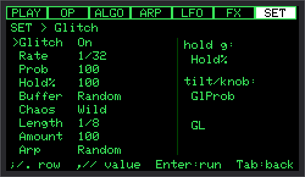

| 項目 | 範囲 | 初期値 | 内容 |
|---|---|---|---|
| `Glitch` | On / Off | Off | 常に起こすか |
| `Rate` | 1/8・1/8T・1/16・1/16T・1/32・1/32T | 1/16 | 判定する刻み（ARP のテンポ、または MIDI クロック） |
| `Prob` | 0〜100% | 25 | Glitch On のときの確率 |
| `Hold%` | 0〜100% | 100 | `g` を押している間の確率 |
| `Buffer` | Off / Stutter / Reverse / Gate / Random | Random | 音の崩し方: Stutter = 直前の断片をくり返す、Reverse = 逆回し、Gate = ぶつ切り |
| `Chaos` | Off / Ratio / Timbre / Wild | Ratio | 音色を一瞬飛ばす: Ratio = 比率、Timbre = 波形・フィードバック、Wild = アルゴリズムまで |
| `Length` | 1/32・1/16・1/8 | 1/16 | 1 回の崩れの長さ |
| `Amount` | 0〜100% | 50 | 崩れの大きさ（くり返しの細かさ・飛ばす幅）。ARP グリッチの回数・長さにも使う |
| `Arp` | Off / Ratchet / Octave / Reverse / Rest / Random | Off | ARP グリッチ（8.3） |

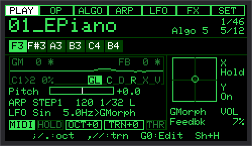

`Buffer` と `Chaos` の両方を選んでいると、そのたびにどちらかが起きます。PLAY の `GL` が反転している間が、崩れている瞬間です。

### 8.3 ARP グリッチ

ARP のステップごとに、同じ確率（`Prob` / `Hold%` / `GlProb`）で判定します。ARP が Off のときは何も起きません（`Arp` の行に `ARP is off` と出ます）。

| 種類 | 効果 |
|---|---|
| `Ratchet` | そのステップの中で同じ音を 2〜4 回打ち直す（`Amount` で回数。1 回が 15ms を下回るときは減らす） |
| `Octave` | そのステップだけ 1 オクターブ上か下へ（範囲を出るときは反対側へ） |
| `Reverse` | 2〜8 ステップ（`Amount`）の間、ARP の進む向きが逆になり、そこから元の向きで続ける |
| `Rest` | そのステップを鳴らさない（位置は進む） |
| `Random` | 毎回 4 つから選ぶ |

崩れた音も、ARP の MIDI 出力（`ArpSend`）が On ならそのまま送ります。パターンの中身は変わりません。

---

## 9. パッチ

パッチは音色の設定一式です。**ARP・MIDI・IMU の On / Off・画面の設定などは本体の設定**で、パッチには入りません。

### 9.1 `SET > Patch`

| 項目 | 内容 |
|---|---|
| `Load` | 一覧から読み込む（`;` `.` で選び `Enter`、`Tab` で戻る） |
| `Save` | 今のパッチに上書き（確認あり） |
| `SaveAs` | 名前を付けて保存（12 文字まで、英数字と `-` `_` `.`）。同じ名前があれば上書きの確認 |
| `Rename` / `Dup` / `Delete` | 名前を変える / 複製 / 削除 |
| `Reset` | 初期の音（Init）に戻す。FX はすべて Off（確認あり） |
| `Random` | ランダムな音を作る |
| `Morph >` | モーフの画面（10 章） |
| `Factory` | ファクトリーパッチとファクトリーのチェーンを、すべて元に戻す |

### 9.2 ファクトリーパッチの保護

- `01_` のように数字 2 桁と `_` で始まる 32 個は、**上書きできません**。Save を選ぶと、別の名前で保存する画面になります（例: `01_EPiano` → `EPiano2`）
- 消すことはできます。`Factory` で戻ります
- ファームウェアを新しくしてファクトリーパッチが改良されたときは、起動時に自動で書き直されます（自分のパッチはそのまま）

### 9.3 一覧の順と Program Change

一覧は、**ファクトリーパッチ 32 個が先頭**（01〜32 の順）、そのあとに自分のパッチが名前の順で並びます。MIDI の Program Change N は、一覧の N+1 番目を読み込みます（0〜31 がファクトリーパッチ）。パッチは 128 個まで保存できます。

### 9.4 ファイル

| ファイル | 中身 |
|---|---|
| `/MORPHASE/Patch/<名前>.json` | パッチ（テキスト。そのままコピーして共有できる） |
| `/MORPHASE/current.json` | 今の音（電源を切っても残る） |
| `/MORPHASE/settings.json` | 本体の設定 |
| `/MORPHASE/morph.txt` | 編集中のチェーン |
| `/MORPHASE/Chain/<名前>.txt` | 保存したチェーン |
| `/MORPHASE/Pattern/0〜7.json` | ARP の STEP パターン |

**パッチを読み込んだあと（SET の Load・Program Change・`Pch+` / `Pch-`）、SET の画面を `Tab` で抜けたとき・`G0` で PLAY に戻ったとき、音量などを変えたときは、最後の操作から 3 秒たち、演奏していない時（鳴っている音が無く、ARP が止まっているとき）にまとめて保存します**（SD に書く間は MIDI・ARP・画面が一瞬止まるため、演奏の邪魔をしないようにしています）。変わったファイルだけを書きます。弾き続けている間と、音が消えてから 3 秒以内に電源を切ると、直前の変更は保存されません。Save / SaveAs / Rename / Dup / Delete などのはっきりした保存の操作は、その場で書きます。

保存は、いったん一時ファイルに書いてから入れ替えます。書いている途中で電源が切れても、起動時に元に戻ります。

---

## 10. パッチモーフ

パッチからパッチへ、音をなめらかに移していく機能です。比率・レベル・エンベロープ・FX など、**パッチの値をまるごと**混ぜていきます。

### 10.1 `SET > Patch > Morph`（`MORPH > Slots`）

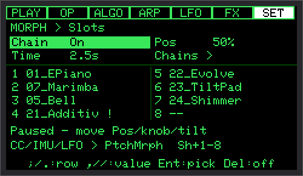

| 項目 | 内容 |
|---|---|
| `Chain` | On / Off。チェーン（10.2）を使うか |
| `Pos` | チェーンの位置（0〜100%） |
| `Time` | グライド（10.3）の時間（0〜10 秒、初期値 1 秒） |
| `Chains >` | チェーンの保存・読み込み（10.4） |
| スロット 1〜8 | `Enter` か `/` でパッチを選ぶ、`,` か `Del` で空にする |

アルゴリズムが前のスロットと違うスロットには `!` が付きます。そこを通るときは、途中（半分の位置）で音が切り替わります。**同じアルゴリズムのパッチどうしなら、なめらかにつながります。**

下の行に今の状態（`Now 1>2 45%  pos 45%` / `Paused …` / `Chain off` / `Glide > 3 45%`）が出ます。

### 10.2 チェーン（位置で混ぜる）

スロット 1 から途切れずに埋まっている部分が「チェーン」です。その全体を 1 つの位置（0〜100%）で行き来します。

- 位置を動かすには、`Pos` のほか、**行き先 `PtchMrph`** を使います（MIDI のノブ・傾き・LFO・テルミン）
- **ノブで動かすときは、ノブのスロットの行き先を `PtchMrph` にします。** CC#1・CC#74 は最初から `GMorph`（波形）なので、チェーンは動きません
- チェーンが動いている間に、別のパッチを読み込んだり、音を編集したりすると、チェーンは**一時停止**します（PLAY に `C paused`）。`Pos`・`PtchMrph` のノブ・傾き・テルミンを動かすと再開します（LFO では再開しない）。一時停止は電源を切っても残ります

### 10.3 グライド（スロットへ移る）

`Shift+1`〜`Shift+8` で、今聞こえている音からそのスロットのパッチへ、`Time` をかけて移ります（PLAY に `M>3 45%`）。着いたら、そのパッチを読み込んだのと同じになります。途中で別のスロットを押すと、その時点の音から向かい直します。チェーンが On でも Off でも使えます。

**Program Change でも**: `SET > MIDI > PC Mode` を `Morph` にすると、Program Change 0〜7 でスロット 1〜8 へグライドします。8 以上は無視して `PC 9 ignored (Morph: 0-7)` と知らせます。

### 10.4 チェーンの保存（`Chains >`）

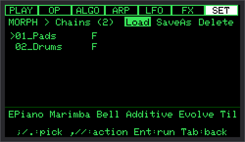

スロットに並べたパッチ（編集中のチェーン）を、名前を付けて何本でも保存できます。

| 操作 | 内容 |
|---|---|
| `;` / `.` | チェーンを選ぶ（下に中身のパッチ名） |
| `,` / `/` | Load / SaveAs / Delete を選ぶ |
| `Enter` | 実行（Load・上書き・削除は確認あり） |
| `Tab` | Morph の画面に戻る |

- 保存されるのは、スロット 1〜8 のパッチ名と `Time` です
- 読み込んだチェーンのパッチがカードに無いときは、そのスロットを空にして知らせます
- **ファクトリーのチェーン**（`F` の印）: `01_Pads`（鍵盤 → マレット → ベル → 加算合成のパッド）、`02_Drums`（`25_Kick` ⇔ `26_Tom`）。その名前では保存できず、消しても `Factory` で戻ります。読み込んでも `Time` は変えません

### 10.5 チェーンを MIDI で切り替える（`Chain+` / `Chain-`）

MIDI のボタン（11.5）に `Chain+` / `Chain-` を割り当てると、最後に読み込んだチェーンの次・前を読み込みます（まだ読み込んでいなければ一覧の先頭から、端ではループ）。

> 読み込みでは 8 つのパッチをカードから読むので、0.1〜0.2 秒ほど画面と MIDI の処理が止まります（音は止まりません）。**曲間・場面の変わり目向け**です。

### 10.6 似た名前の整理

| 名前 | 場所 | 動かすもの |
|---|---|---|
| `GMorph` | ALGO タブ・行き先 | 4 つの OP の**波形**（1 つのパッチの中） |
| `OpMorph` | 行き先（OP タブの `Morph`） | 選んでいる 1 つの OP の**波形** |
| `PtchMrph` | 行き先 | **チェーンの位置**（パッチからパッチへ） |
| `Glide`（ALGO タブ） | パッチ | **音程**が次の音へ滑る時間（ms） |
| `Time`（Morph の画面） | 本体の設定 | **パッチからパッチへ**移る時間（秒） |

---

## 11. MIDI

### 11.1 受けるもの

ノート（ベロシティ付き）、ピッチベンド、コントロールチェンジ、プログラムチェンジ、MIDI クロック（Start / Continue / Stop）。通常版は Unit MIDI（本体の Grove、31250bps）、BLE 版はさらに Bluetooth MIDI（12 章）。

### 11.2 `SET > MIDI`

| 項目 | 範囲 | 内容 |
|---|---|---|
| `Channel` | Omni / 1〜16 | 受信チャンネル（初期値 Omni） |
| `BendRng` | 1〜12 半音 | ピッチベンドの幅 |
| `ArpSend` | On / Off | ARP の音を MIDI で送る（Unit MIDI の OUT） |
| `PtnBase` | Off / CC 番号 | パターン直接選択の最初の CC（5.1） |
| `PC Mode` | Patch / Morph | Program Change で、パッチを読み込む / スロットへグライド（10.3） |
| `CC Slots >` | | ノブのスロット（11.4） |
| `Switches >` | | ボタンのスロット（11.5） |
| `Assigned >` | | 割り当ての一覧（CC 番号の順） |
| `BLE` | On / Off | BLE 版だけ。変えたら再起動（12 章） |

### 11.3 決まっている CC

| CC | 内容 |
|---|---|
| 1（モジュレーション）・74 | `GMorph` |
| 2（ブレス） | `Feedbk` |
| 7 | 音量（フェーダー） |
| 11 | エクスプレッション |
| 64 | サステインペダル |
| 120 / 123 | 音をすべて止める |

### 11.4 ノブのスロット（4 つ）と MIDI Learn

各スロットは `CC`（番号）・`Tgt`（行き先）・`Dep`（深さ 0〜100%）を持ちます。

- **MIDI Learn**: `n CC` の行で `Enter` → `Learn... turn a knob` と出たら、割り当てたいノブを回す（10 秒で取り消し、もう一度 `Enter` でも取り消し）。実際に動いた CC を覚えるので、ノブの番号を知らなくても大丈夫です
- ノブの位置が、そのまま行き先の値になります（`Volume` はフェーダーのように絞る、`Pitch` と `PEnvAmt` は中央が 0）
- まだ一度も CC を受けていないスロットは、何もしません
- 同じ CC を 2 か所に割り当てることもできます（覚えたときに `already used!` と知らせます）

### 11.5 ボタンのスロット（4 つ）

各スロットは `CC`・`Act`（動作）・`Mod`（Toggle = 押すたびに切り替え / Moment = 押している間だけ）を持ちます。

| 動作 | 内容 |
|---|---|
| `Arp` / `Latch` / `Hold` / `Glide` | ARP の On/Off / ラッチ / ノートホールド / グライドの On/Off |
| `Pch+` / `Pch-` | 次 / 前のパッチ |
| `Pat+` / `Pat-` | 次 / 前の ARP パターン |
| `Tap` | タップテンポ |
| `RndPch` / `RndPat` | ランダムなパッチ / パターン |
| `Panic` | すべての音を止める |
| `BypCho` 〜 `BypDrv` | FX ショートカット（7.4） |
| `Glitch` | GLITCH（8.1） |
| `Theremin` | テルミンの On / Off |
| `Chain+` / `Chain-` | 次 / 前のチェーン（10.5） |

### 11.6 MIDI クロック

ARP タブの `ClkSync` が On のとき、外部の MIDI クロックに ARP と GLITCH の刻みを合わせます。Start を受けると先頭からやり直します。

---

## 12. BLE MIDI（BLE 版）

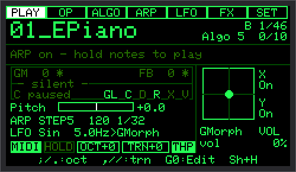

BLE 版は、Bluetooth MIDI の機器として `MORPHASE` という名前で見えます。受けるだけで、DIN の MIDI と同時に使えます。ノート・ベンド・CC・MIDI Learn・サステイン・Program Change・クロックは、DIN とまったく同じに動きます。

| 項目 | 内容 |
|---|---|
| つなぎ方 | iPhone / iPad は、**アプリの中**（Bluetooth MIDI の接続画面）から `MORPHASE` を選ぶ。スマートフォンの「設定」の Bluetooth からではない |
| 表示 | PLAY の名前の右に `b`（接続待ち、暗い）/ `B`（接続中）。Info に `(Adv/Conn/Off/Fail)` と受信のバイト数 |
| 切断したとき | 鳴っている音はすべて止まり、ペダルも上がった扱いになる（鳴りっぱなしにならない） |
| On / Off | `SET > MIDI > BLE`（初期値 On）。変えると再起動するか聞かれる |
| テンポ | BLE は約 10ms ごとにまとめて届くので、クロックは DIN より揺れる。テンポの同期は DIN の方が安定 |
| つながらないとき | 以前、同じ Cardputer を別のファームウェアで登録したことがあるなら、スマートフォンの Bluetooth の設定から古い登録を解除する（MORPHASE は専用のアドレスを使う） |

確認済みの機器: iPhone・iPad（アプリ [KeyPad](https://www.discodsp.com/jp/keypad/)）。BLE 版は同時に鳴らせる音が 10 音で、画面の色数が少なくなっています（256 色）。

---

## 13. SETTING

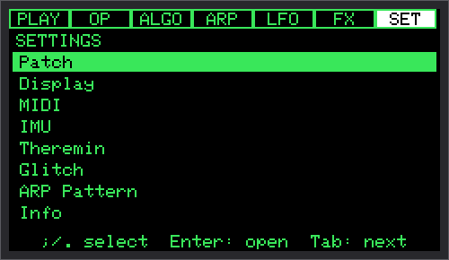

`SET` タブで、`;` `.` でカテゴリを選び `Enter` で開きます。`Tab` で戻ると、3 秒後、演奏していない時に設定が保存されます（9.4）。

### 13.1 Patch

9 章・10 章を参照してください。

### 13.2 Display

| 項目 | 内容 |
|---|---|
| `Theme` | 画面の色: Green / Amber / Cyan / Violet / Red |
| `Bright` | 明るさ（10〜100） |
| `GM/FB` / `MorphPos` / `FX stat` / `GL` | PLAY のスコープの上の文字を、それぞれ出す / 消す |

### 13.3 MIDI

11 章を参照してください。

### 13.4 IMU

左の列が X 軸、右の列が Y 軸です。

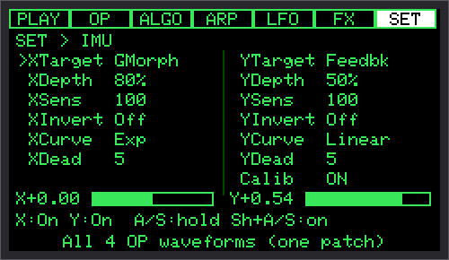

| 項目 | 範囲 | 内容 |
|---|---|---|
| `XTarget` / `YTarget` | 行き先（6.3） | **パッチの設定** |
| `XDepth` / `YDepth` | 0〜100% | **パッチの設定**。初期値 50% |
| `XSens` / `YSens` | 50〜200% | 感度。100% で 35° 傾けたとき全範囲 |
| `XInvert` / `YInvert` | On / Off | 向きを逆に |
| `XCurve` / `YCurve` | Linear / Exp | Exp = 少しの傾きでは控えめに、大きく傾けると大きく |
| `XDead` / `YDead` | 0〜30% | 中央の動かない範囲（初期値 5%） |
| `Calib` | ON / OFF | `Enter` で、今の持ち方を「水平」として覚える |

下に、今の傾きの値とバーが出ます。

### 13.5 Theremin

M5Stack **Unit ToF4M**（距離センサー）で、手をコントローラーにします。本体の設定です。

**挿す場所**（`Bus`）:

| 端子 | 挿すもの |
|---|---|
| 本体の Grove（G1 / G2） | Unit MIDI。DIN の MIDI はここだけを読む |
| LoRa Cap の Grove（G8 / G9） | ToF、`Bus` = `Cap`（初期値・おすすめ）。DIN の MIDI と同時に使える。この端子は本体の中の I2C のバスなので、Unit MIDI は使えない |
| `Bus` = `Grove` | LoRa Cap が無いとき、ToF を本体の Grove に。**テルミンが On の間、DIN の MIDI は使えない**（BLE 版は BLE の MIDI が使える） |

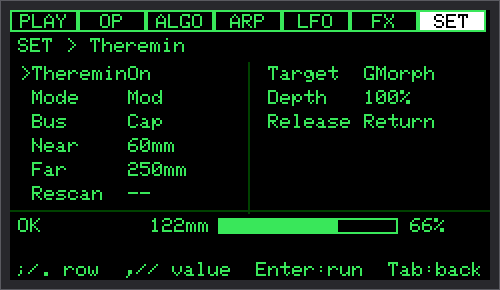

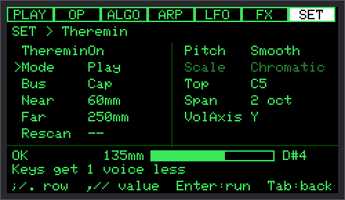

**設定**（左は共通、右は `Mode` で使うものだけ）:

| 項目 | 範囲・初期値 | 内容 |
|---|---|---|
| `Theremin` | On / Off（Off） | MIDI のボタン `Theremin` でも切り替え |
| `Mode` | Mod / Play（Mod） | Mod = 距離が変調の入口、Play = テルミンが音を鳴らす |
| `Bus` | Cap / Grove（Cap） | 上の表 |
| `Near` | 20〜200mm（60） | 範囲の近い端 |
| `Far` | Near+100〜1000mm（250） | 範囲の遠い端。部屋の明かりの下では約 280mm まで |
| `Rescan` | | センサーを探し直し、バスの機器を数える（Cap では本体の機器も含めて `N shared`） |
| `Target` / `Depth` | 行き先（GMorph）/ 0〜100%（60） | Mod: 何を動かすか。手が近いほど深く。印 `^` |
| `Release` | Hold / Return（Return） | Mod: 手が無いとき、最後の値のまま / 0 へ戻る |
| `Pitch` | Smooth / Semitone（Smooth） | Play: なめらか（本物のテルミン）/ 音階にスナップ |
| `Scale` | 49 種（Chromatic） | Play・Semitone: スケール。主音は C で、トランスポーズで動く。選んでいる間、下に正式な名前 |
| `Top` | C4 から ±オクターブ（C5） | Play: `Near` での音 |
| `Span` | 1〜4 oct（2） | Play: そこから下の幅 |
| `VolAxis` | Off / X / Y（Y） | Play: 音量を決める傾きの軸（水平で半分、片側で最大、反対側で無音。`A` / `S` で固定）。Play の間、その軸の本来の行き先は止まる（PLAY に `vol`） |

一番下の行に、センサーの状態（`Off` / `Searching` / `OK` / `Lost`）・距離・範囲の中の手の位置のバー・効き具合（Mod は %、Play は音名）が出ます。範囲の端にしたい位置に手をかざして、`Near` / `Far` を決められます。

**Play のときの声**: テルミン専用に最後の 1 声を使うので、鍵盤の声は 1 つ減ります（11 声、BLE 版は 9 声）。テルミンの音は、鍵盤のノート・サステインペダル・All Notes Off に関わらず、ARP や MIDI 出力にも送られません。モノのパッチでも、鍵盤の 1 音と手の 1 音が別々に鳴ります。センサーを抜くと約 2 秒で `Lost` になり、挿し直すと自動で戻ります。

### 13.6 Glitch

8 章を参照してください。

### 13.7 ARP Pattern

| 項目 | 内容 |
|---|---|
| `Slot` | パターンのスロット（0〜7） |
| `Load` / `Save` | そのスロットを読み込む / 保存 |
| `Random` | 弾けるランダムなパターンを作る |

### 13.8 Info

15 章を参照してください。

---

## 14. ファクトリーパッチ一覧

すべてのファクトリーパッチは、Drive を使うもの（16・17）と Crush を使うもの（30）以外は歪みません。音量は、種類ごとにそろえてあります。**傾き**は `Shift+A` / `Shift+S` で On にしたときの動きです（特に書いていないものは、X = 波形、Y = ざらつき）。

### 鍵盤（01〜04）

| # | 名前 | Algo | ひとこと | 触りどころ |
|---|---|---|---|---|
| 01 | `01_EPiano` | 5 | エレクトリック・ピアノ（胴鳴り + ティン） | 強く弾くとティンが鳴る。`07_Marimba` とモーフ |
| 02 | `02_EPBright` | 5 | 明るい E.Piano | 強弱の差が大きい |
| 03 | `03_Clav` | 3 | 歯切れのよいクラビネット | 短く弾く。`t` で Drive を足すとファンク |
| 04 | `04_Organ` | 8 | 4 本の正弦波のドローバー・オルガン | 押している間ずっと鳴る。傾き X で音色 |

### ベル・マレット（05〜08）

| # | 名前 | Algo | ひとこと | 触りどころ |
|---|---|---|---|---|
| 05 | `05_Bell` | 5 | ベル | 高い音域で。`e` で Reverb を増やす |
| 06 | `06_Gong` | 14 | 銅鑼 | 低い音を長く。長い Reverb |
| 07 | `07_Marimba` | 5 | マリンバ | `01_EPiano` とモーフ（同じアルゴリズム） |
| 08 | `08_Glock` | 13 | グロッケン | 高い音域で |

### ベース（09〜12、モノ・Legato）

| # | 名前 | Algo | ひとこと | 触りどころ |
|---|---|---|---|---|
| 09 | `09_Bass` | 5 | 基本の FM ベース | つないで弾くと滑る |
| 10 | `10_Growl` | 10 | うなるベース | LFO でうなる。傾き X でうなりの強さ |
| 11 | `11_SawBass` | 12 | のこぎり波のベース | 強く弾くと明るい。`Feedbk`（傾き Y）で荒さが変わる |
| 12 | `12_SubBass` | 4 | 低いサブベース | イヤホンで |

### リード（13〜16、モノ・Legato）

| # | 名前 | Algo | ひとこと | 触りどころ |
|---|---|---|---|---|
| 13 | `13_MorphLd` | 7 | 波形が動くリード | **傾き X で波形**（深め）。LFO でゆっくり動く。Delay |
| 14 | `14_SawLead` | 9 | のこぎり波のリード | 0.6 秒後からビブラート。Delay |
| 15 | `15_Whistle` | 4 | 口笛 | 0.7 秒後からビブラート |
| 16 | `16_DirtyLd` | 2 | 歪んだリード | **Drive を使う**。`t` で Drive を外すときれいな音に |

### ブラス・ストリングス・パッド（17〜20）

| # | 名前 | Algo | ひとこと | 触りどころ |
|---|---|---|---|---|
| 17 | `17_Brass` | 2 | ブラス | **Drive でエッジ**。強く弾くと明るい |
| 18 | `18_Strings` | 7 | ストリングス | ゆっくり弾く。遅れて入るビブラート |
| 19 | `19_WarmPad` | 5 | 暖かいパッド | 立ち上がり約 1 秒。LFO でゆっくり波形が動く |
| 20 | `20_Choir` | 5 | 声のようなパッド | ビブラート。Chorus と Reverb |

### 加算合成・変化するパッド（21〜24、すべて Algo 7）

| # | 名前 | Algo | ひとこと | 触りどころ |
|---|---|---|---|---|
| 21 | `21_Additive` | 7 | 正弦波を重ねたオルガン風 | `22`〜`24` とモーフ（同じアルゴリズム） |
| 22 | `22_Evolve` | 7 | ゆっくり変わり続けるパッド | 押し続ける。LFO（0.1Hz） |
| 23 | `23_TiltPad` | 7 | 傾けて弾くパッド | **傾き X が主役**（深い）。LFO は無し |
| 24 | `24_Shimmer` | 7 | きらめくパッド | 1・4・8 倍の音。長い Reverb |

### ドラム（25〜28、ポリの単発）

| # | 名前 | Algo | ひとこと | 触りどころ |
|---|---|---|---|---|
| 25 | `25_Kick` | 4 | キック | C1〜C2 で。強く弾くと落ちが深い。`26_Tom` とモーフ（`02_Drums`） |
| 26 | `26_Tom` | 4 | タム | 音階に並べて弾ける |
| 27 | `27_Snare` | 6 | スネア（皮 + 響き線） | C3 あたりで |
| 28 | `28_HiHat` | 1 | ハイハット | どの鍵盤でも同じ高さ。8 分で刻む |

### 金属・ノイズ・ドローン（29〜32）

| # | 名前 | Algo | ひとこと | 触りどころ |
|---|---|---|---|---|
| 29 | `29_Metallic` | 11 | 金属的な倍音 | 和音で。Delay |
| 30 | `30_CrushLd` | 9 | Crush で荒らしたモノのリード | `r` で Crush を外すときれいなリードに |
| 31 | `31_NoiseSwl` | 1 | 音程のあるノイズ | 約 1.5 秒で膨らむ。LFO で息づく。**傾き X で波形** |
| 32 | `32_Drone` | 7 | ドローン | 長く押さえる。LFO で動き続ける。**傾き X で GLITCH が起きやすくなる**（Glitch が Off でも） |

---

## 15. Info 画面（`SET > Info`）

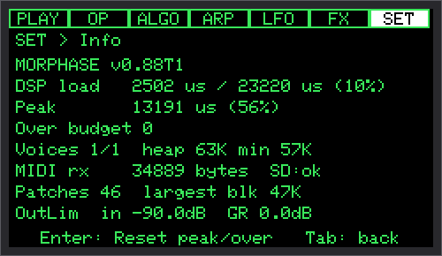

| 行 | 内容 |
|---|---|
| 1 行目 | 版（BLE 版は ` BLE` と接続の状態 `(Adv/Conn/Off/Fail)`） |
| `DSP load` | 今の 1 回分の音の処理の時間 / 上限 23,220us |
| `Peak` | 起動から（または Enter から）の最大。85% までなら安全 |
| `Over budget` | 上限を超えた回数（0 以外だと赤。音が途切れた可能性） |
| `Voices … heap … min …` | 鳴っている音 / 声の数、空きメモリ、起動からの最小の空きメモリ |
| `MIDI rx` / `rx … BLE … ov` | 受信したバイト数（BLE 版は DIN と BLE、あふれた数）、SD の状態 |
| `Patches … largest blk …` | パッチの数、一番大きい空きメモリの塊（BLE 版は `stk`: Bluetooth の処理のスタックの使用量） |
| `OutLim in … GR …` | 出力のリミッターに入る最大の大きさ（0dB = 上限）と、下げた量（この 1 秒） |

`Enter` で Peak と Over を 0 に戻します。

---

## 16. 困ったとき・既知の制限

### 困ったとき

| 症状 | 確かめること |
|---|---|
| 音が出ない | 本体の音量（`VOL`）、`MIDI` の印が点くか、受信チャンネル、microSD |
| Unit MIDI で受けない | DIP スイッチ BYPASS、Grove の 5V スイッチ 5VOUT、テルミンの `Bus` が `Grove` になっていないか（PLAY に `-DIN`） |
| ノブでチェーンが動かない | ノブのスロットの行き先が `PtchMrph` か（CC#1 / #74 は GMorph）、PLAY が `C paused` なら Pos かノブを動かす |
| IMU で何も変わらない | `Shift+A` / `Shift+S` で On にしたか、`SET > IMU` の Depth が 0 でないか |
| テルミンが `Lost` / `Searching` | 挿す場所と `Bus` が合っているか、`Rescan` |
| 音が歪む | Drive / Crush を使っていないか（`t` / `r` で外して比べる） |
| 本体のキーが効かない | 下の「キーボードの凍結」 |

### 既知の制限

- **キーボードの凍結**: ごくまれに、本体のキーが一切反応しなくなります。Cardputer ADV のキーボードのチップ（TCA8418）の既知の癖です。**30 秒ほどで自動的に再起動して戻ります。** 30 秒同じキーを押し続けたときにも、再起動することがあります
- **LFO の点**: 速い LFO では、点がゆっくり・逆に見えることがあります（6.1）
- **チェーンの読み込み**: 0.1〜0.2 秒、画面と MIDI の処理が止まります（10.5）
- **アルゴリズムの違うパッチのモーフ**: 途中で音が切り替わります（10.1）
- **出力のリミッター**: 大きな和音のあと、音量が戻るまで約 0.65 秒（7.5）
- **BLE 版**: 10 声、画面は 256 色、クロックは DIN より揺れる。確認済みの機器は iPhone・iPad（アプリ KeyPad）
- **オリジナルの Cardputer**（ADV でない方）には対応していません
- パッチは 128 個まで、チェーンの一覧は 64 本まで表示

それでも解決しないときは、GitHub の Issue か、開発者（@Tokagetchi）までご連絡ください。
